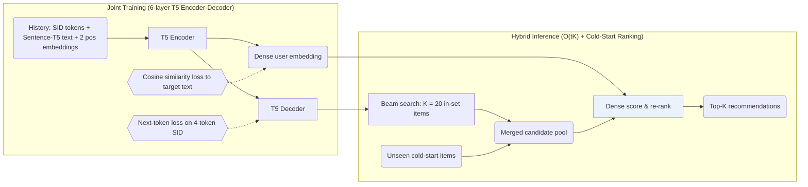

## At a Glance

Key Findings: By combining K = 20 beam-searched SID candidates with cold-start items for dense re-ranking, LIGER narrows the performance gap to full-catalog dense retrieval and improves cold-start recommendation across Amazon Beauty, Sports, Toys, and Steam (Abstract, Sec. 4.2, Table 2).
Limitation: Every cold-start item joins the candidate set, and the design assumes that cold-start items are few (Sec. 3).

### 1. Why This Paper Matters

Sequential dense retrieval stores a continuous vector per item so memory and inference cost scale linearly with catalog size, whereas generative retrieval decodes compact Semantic IDs (SIDs) via beam search (Abstract, Table 1). Through a controlled comparison, the paper shows that generative retrieval lags behind dense retrieval on warm items and almost never generates unseen cold-start items because its token probabilities overfit to training items (Sec. 2.4). LIGER bridges both regimes by training one encoder-decoder with joint generative and dense objectives and ranking beam candidates together with cold-start items.

> "Our findings indicate that the model's learned conditional probabilities tends to overfit to items seen during training, leading to a significantly reduced capability to generate cold-start items." (Sec. 2.4)

### 2. How It Works

#### Input and Training

Each item in the user history is represented by summing its SID token embeddings, its frozen Sentence-T5-XXL text embedding, and two position embeddings (item position and token position; Sec. 3, Sec. 4.1). A 6-layer T5 encoder-decoder is trained jointly with next-token prediction over the target item's 4-token SID (3 RQ-VAE levels of 256 codewords plus a uniqueness token) and a cosine-similarity loss aligning the encoder output with the target item's text embedding (Sec. 3, Sec. 4.1).

#### Hybrid Inference

At inference, the decoder runs beam search to propose $`K`$ in-set candidates ($`K = 20`$ in the main experiments), appends all cold-start items to form a compact candidate pool, and ranks the combined pool by dot-product similarity against the encoder's dense output embedding (Sec. 3, Algorithm 1).

> "During inference, the decoder retrieves K items by beam search, then supplemented with cold-start items and ranked with the encoder's output embeddings." (Sec. 3)

Appending the entire cold-start set avoids full-catalog scoring as long as cold-start items remain a small fraction of the catalog between periodic system updates (Sec. 3).

> "This design choice is based on the hypothesis that cold-start items are relatively sparse compared to in-set items, as recommendation systems periodically update themselves to incorporate newly introduced items." (Sec. 3)

### 3. Experimental Findings

- Controlled gap and cold-start failure: when cold-start items are held out from RQ-VAE training (43 items on Beauty, 56 on Toys, 81 on Sports, and 400 on Steam; Table 3), TIGER-style generative retrieval assigns them near-zero generation probability, whereas LIGER recovers cold-start Recall@10 and NDCG@10 across all four datasets over 3 random seeds (Sec. 2.4, Sec. 4.2, Table 2, Figs. 3–4).
- Hybrid candidate sweep: retrieving $`K = 20`$ candidates via beam search and ranking them with cold-start items matches or approaches full-catalog ($`K = N`$) dense ranking at a fraction of the scoring cost, with further gains as $`K`$ increases from 20 to 100 (Sec. 4.2, Table 4, Fig. 1).

### 4. Limitations & Critical Analysis

**Our analysis.**

- In LIGER's hybrid stage, the generated SID acts only as a coarse candidate filter ($`K = 20`$), while the dense dot product determines the final ranking order and all cold-start placements.
- If a streaming platform ingests thousands of new items between tokenizer rebuilds, scoring every cold-start item on each request erodes the $`O(tK)`$ complexity advantage over $`O(N)`$ dense retrieval (Table 1).
- TIGER retrieves by `Beam` search with `NTP` alone; LIGER trains with `NTP + Dense` and performs `Hybrid` generative-plus-dense inference.
