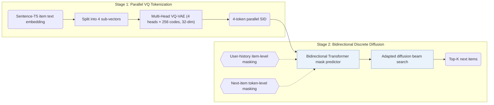
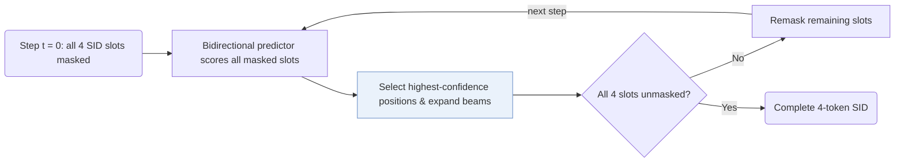

## At a Glance

Key Findings: On Amazon Industrial Scientific, Musical Instruments, and Video Games, LLaDA-Rec outperforms ID-based, diffusion, and autoregressive SID baselines, with adaptive-order unmasking beating fixed left-to-right decoding (Table 3, Sec. 5.4.2, Fig. 4).
Limitation: Fewer diffusion steps improve generation efficiency but lower recommendation performance, and the authors leave a better trade-off as an open question (Sec. 5.4.3, Fig. 5).

### 1. Why This Paper Matters

Autoregressive generative recommenders decode a Semantic ID (SID) one token at a time under causal attention, which restricts each token to attend only to earlier positions and propagates early prediction errors along the fixed left-to-right order. LLaDA-Rec replaces causal left-to-right decoding with discrete masked diffusion and bidirectional attention over parallel SID tokens.

> "To address these issues, we propose LLaDA-Rec, a discrete diffusion framework that reformulates recommendation as parallel semantic ID generation." (Abstract)

### 2. How It Works

#### Parallel Tokenization

Instead of coarse-to-fine residual quantization—which imposes a sequential hierarchy mismatched to bidirectional attention—a Multi-Head VQ-VAE splits each item's Sentence-T5 text embedding into 4 sub-vectors and quantizes each sub-vector independently with its own codebook of 256 codewords (dimension 32), assigning one head per SID slot (Sec. 4.1, Sec. 5.1.4).

#### Masked Training

A bidirectional Transformer mask predictor (4 layers on Scientific and Instrument; 6 layers on Game) is trained with two complementary masking schemes: user-history item-level masking masks entire historical items to capture sequential transitions across items, while next-item token-level masking masks subsets of the target item's 4 SID tokens with the user history visible, teaching the predictor intra-item token co-occurrence (Sec. 4.2.3).

#### Adaptive-Order Decoding

Inference starts at step $`t = 0`$ with all 4 target SID positions masked and unmasks them over a configurable number of steps (Sec. 4.3.4, Sec. 4.4.2). At each step, the predictor scores all masked slots in parallel, keeps the highest-confidence positions, and remasks the remaining slots for re-evaluation in the next step; an adapted beam search tracks multiple candidate trajectories across unmasking steps (Sec. 4.3.3–4.3.4).

> "All unselected positions are remasked so that the MASK predictor can re-evaluate them in the context of the partially generated sequence." (Sec. 4.3.4)

### 3. Experimental Findings

- Main comparison: across Amazon Industrial Scientific, Musical Instruments, and Video Games, LLaDA-Rec outperforms item-ID, continuous diffusion, and autoregressive SID baselines (including TIGER, LETTER, LC-Rec, RPG, and VQ-Rec) on Recall@1/5/10 and NDCG@5/10, with statistically significant improvements under paired t-tests (Table 3).
- Ablations on tokenization and attention: replacing Multi-Head VQ-VAE with hierarchical RQ-VAE, replacing adapted beam search with greedy decoding, or replacing bidirectional attention with causal attention all lower accuracy (Table 4, Fig. 3).
- Unmasking order: adaptive confidence-based unmasking consistently outperforms random and fixed orders, whereas fixed left-to-right decoding occasionally yields the lowest accuracy (Sec. 5.4.2, Fig. 4).

  > "The adaptive approach consistently delivers superior performance, with left2right occasionally producing the poorest results, highlighting the shortcomings of the commonly used left2right scheme." (Sec. 5.4.2)

### 4. Limitations & Critical Analysis

**Our analysis.**

- The Multi-Head VQ-VAE tokenizer is trained once on item text embeddings and held fixed (`Fixed`, `Text`), which suggests that collaborative filtering signals enter only through the bidirectional diffusion generator rather than the SID assignment itself.
- RPG also predicts unordered parallel codes with a `Non-AR` backbone; RPG uses `Par. OPQ` codes and single-pass `Graph`-constrained decoding, whereas LLaDA-Rec uses `Par. VQ` codes and multi-step iterative `Diff.` unmasking.
