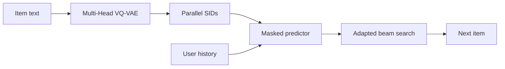

## At a Glance

Limitation: Fewer diffusion steps improve generation efficiency but lower recommendation performance, and the authors leave a better trade-off as an open question (Sec. 5.4.3, Fig. 5).

### 1. Why This Paper Matters

Autoregressive generative recommenders decode a Semantic ID (SID) one token at a time with causal attention. The authors name two limitations of this setup: each token attends only to its predecessors, and errors in early tokens propagate through the fixed left-to-right order (Abstract). LLaDA-Rec replaces left-to-right decoding with discrete diffusion over all SID positions.

> "To address these issues, we propose LLaDA-Rec, a discrete diffusion framework that reformulates recommendation as parallel semantic ID generation." (Abstract)

Based on arXiv v1.

### 2. How It Works

*Figure source: Fig. 2, original paper.*

#### Parallel Tokenization

A Multi-Head VQ-VAE splits the item's text embedding into sub-vectors and quantizes each sub-vector independently, one head per SID position (Sec. 4.1). The authors use this scheme because residual quantization does not match a bidirectional architecture (Abstract).

#### Masked Training

Training uses two masking mechanisms (Abstract). User-history masking captures sequential dependencies between items. Next-item masking masks tokens of the target item's SID while the user history stays visible, so the predictor learns relationships between tokens of the same item (Sec. 4.2.3).

#### Adaptive-Order Decoding

Inference starts from a fully masked SID and fills it over several steps (Sec. 4.3.4). At each step the model selects positions to keep and remasks the rest.

> "All unselected positions are remasked so that the MASK predictor can re-evaluate them in the context of the partially generated sequence." (Sec. 4.3.4)

The number of steps is controllable, and each step can predict several tokens (Sec. 4.4.2). An adapted beam search keeps several candidates during this process, because standard beam search does not fit diffusion-based generation (Abstract).

### 3. Experimental Findings

- Main comparison: LLaDA-Rec outperforms ID-based and generative recommenders on three real-world datasets (Abstract).
- Generation order: the adaptive order performs best, and left-to-right sometimes performs worst (Sec. 5.4.2, Fig. 4).

  > "The adaptive approach consistently delivers superior performance, with left2right occasionally producing the poorest results, highlighting the shortcomings of the commonly used left2right scheme." (Sec. 5.4.2)

### 4. Limitations & Critical Analysis

**Our analysis.**

- The tokenizer is trained once and kept fixed (`Fixed`), and it encodes item text only (`Text`). This suggests that collaborative signals enter only through the generator.
- RPG also generates parallel codes with a `Non-AR` generator; RPG uses `Par. OPQ` codes and `Graph` decoding, while LLaDA-Rec uses `Par. VQ` codes and `Diff.` decoding.
