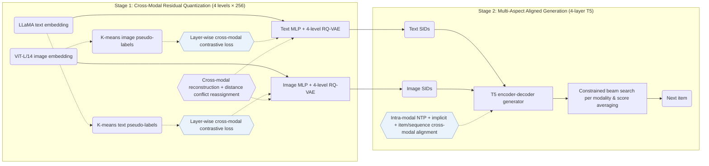

## At a Glance

Key Findings: MACRec leads all baselines on HR@10, NDCG@5, and NDCG@10 on all three datasets, while on Games HR@5 MISSRec reports 0.0674 against 0.0671 for MACRec (Table 2).
Limitation: MACRec trains separate 4-level RQ-VAE tokenizers and runs constrained beam search in both text and image modalities before averaging their scores at inference, and the paper does not report beam width or inference latency (Methodology, Table 4).

### 1. Why This Paper Matters

Generative recommenders require hierarchical, low-collision Semantic IDs (SIDs) that support sequence-to-sequence training. Earlier multimodal generative recommenders quantize each modality independently, so text and image features never guide each other's codebook assignments.

> "However, existing multimodal GR models typically encode each modality separately to obtain semantic IDs for different modalities." (Related Work)

MACRec couples text and visual modalities at two stages: cross-modal contrastive quantization inside the residual codebooks and multi-aspect cross-modal alignment tasks during generator training (Methodology).

### 2. How It Works

#### Dual-Modality Pseudo-Labels

MACRec clusters items independently in LLaMA text-embedding space and in ViT-L/14 image-embedding space; the resulting cluster assignments define cross-modal positive pairs for residual contrastive learning (Dual-modality Pseudo-label Generation).

#### Cross-Modal Quantization

Each modality passes through an MLP encoder and a 4-level × 256-codeword RQ-VAE. At every residual quantization layer, a cross-modal contrastive loss supervises one modality's residuals with the pseudo-labels from the other modality (Cross-modal Quantization with Contrastive Learning).

> "More concretely, we use visual pseudo-labels to enhance the residual representations of the text modality, and conversely, use textual pseudo-labels to optimize those of the visual modality." (Cross-modal Quantization with Contrastive Learning)

Cross-modal reconstruction and VQ losses preserve fidelity to the original embeddings (Cross-modal Reconstruction Alignment), and remaining ID collisions are resolved as in MQL4GRec by reassigning codewords based on item-to-codebook distances.

#### Multi-Aspect Alignment

A 4-layer T5 encoder-decoder trains jointly on intra-modal next-item prediction, implicit contrastive alignment between text and visual SID representations, and explicit item-level translation and sequence-level cross-modal prediction tasks; at inference, constrained beam search runs in each modality and averages the two candidate scores (Generative Recommendation with Multi-aspect Alignment).

> "For sequence-level alignment, we construct a prediction task where a historical sequence of textual semantic IDs is used to predict the visual semantic ID of the next recommended item." (Explicit Alignment with Different Generation Tasks)

### 3. Experimental Findings

- Full-catalog ranking: across Amazon Musical Instruments, Arts Crafts and Sewing, and Video Games, MACRec outperforms sequential, multimodal, and generative baselines (including TIGER, P5-CID, and MQL4GRec without extra-category pre-training) on HR@10, NDCG@5, and NDCG@10, trailing only MISSRec on Games HR@5 (0.0671 vs. 0.0674; Table 2).
- Module ablations: removing cross-modal quantization, implicit alignment, or explicit cross-modal generation tasks lowers HR@10 across all three datasets (Table 3, Figs. 3–4).
- Pre-resolution collision rates: cross-modal contrastive quantization lowers item SID collision rates below single-modality RQ-VAE and MQL4GRec, reaching 2.38% for text and 3.23% for images on Musical Instruments before distance-based reassignment (Table 4).

### 4. Limitations & Critical Analysis

**Our analysis.**

- MQL4GRec quantizes text and images with separate tokenizers (`Dual RQ`) and links them only in generator tasks; MACRec couples the residual levels during tokenization (`Cross RQ`) and adds contrastive alignment to the generator (`NTP + Ctr.`), while retaining MQL4GRec's distance-based conflict reassignment and dual-modality score averaging.
- MACRec encodes text and images without collaborative signals (`Text+Img`). CARD later incorporates collaborative neighbors alongside visual and textual fields (`Text+Img+CF`) and quantizes a unified visual card with `NU-RQ`.
