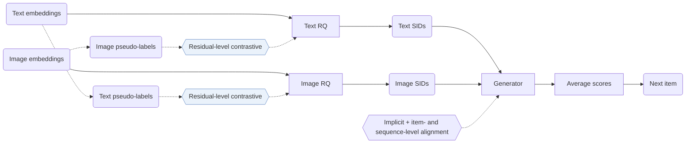

## At a Glance

Key Findings: MACRec leads all baselines on HR@10, NDCG@5, and NDCG@10 on all three datasets, while on Games HR@5 MISSRec reports 0.0674 against 0.0671 for MACRec (Table 2).

### 1. Why This Paper Matters

Generative recommendation needs Semantic IDs (SIDs) that are hierarchical, have few conflicts, and support generator training (Abstract). Earlier multimodal generative recommenders quantize each modality on its own, so text and image do not inform each other's IDs.

> "However, existing multimodal GR models typically encode each modality separately to obtain semantic IDs for different modalities." (Related Work)

MACRec adds cross-modal interaction at two points: inside the quantizer and in the generator's training tasks (Methodology).

### 2. How It Works

#### Dual-Modality Pseudo-Labels

MACRec clusters items separately by their text embeddings and by their image embeddings. The cluster labels define positive pairs for contrastive learning in the quantizer (Dual-modality Pseudo-label Generation).

#### Cross-Modal Quantization

Each modality passes through an MLP and a residual quantizer. A contrastive loss at the residual levels uses the labels of the other modality (Cross-modal Quantization with Contrastive Learning).

> "More concretely, we use visual pseudo-labels to enhance the residual representations of the text modality, and conversely, use textual pseudo-labels to optimize those of the visual modality." (Cross-modal Quantization with Contrastive Learning)

Reconstruction and quantization losses keep the codes able to recover the original embeddings (Cross-modal Reconstruction Alignment).

#### Multi-Aspect Alignment

The generator trains on next-item prediction within each modality, an implicit alignment of the two SID representations, and explicit item-level and sequence-level tasks across modalities (Generative Recommendation with Multi-aspect Alignment).

> "For sequence-level alignment, we construct a prediction task where a historical sequence of textual semantic IDs is used to predict the visual semantic ID of the next recommended item." (Explicit Alignment with Different Generation Tasks)

### 3. Experimental Findings

- Ablation: removing any module lowers HR@10 on all three datasets (Table 3).
- Collisions: MACRec has lower item ID collision rates than MQL4GRec (Table 4).

### 4. Limitations & Critical Analysis

**Our analysis.**

- MQL4GRec also builds separate text and image SIDs (`Dual RQ`); MACRec replaces this with `Cross RQ` and adds a contrastive term to the generator objective (`NTP + Ctr.`).
- The representation uses text and image only (`Text+Img`). CARD adds collaborative signals (`Text+Img+CF`) and quantizes one combined input with `NU-RQ`.
