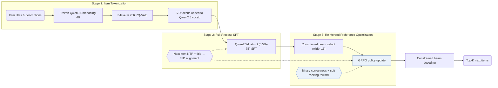

## At a Glance

Key Findings: Scaling the Qwen backbone from 0.5B to 7B parameters monotonically lowers training and evaluation losses, and combining full-process SID alignment with GRPO and constrained beam rollouts outperforms traditional, generative, and LLM baselines on Amazon Industrial and Office (Abstract, Sec. 5.2, Table 1, Fig. 1).
Limitation: The scaling study measures training and evaluation losses as the model grows, not ranking metrics (Sec. 5.2, Fig. 1).

### 1. Why This Paper Matters

Industrial generative recommenders that replace item embedding tables with Semantic ID (SID) sequences remain largely proprietary, leaving open whether parameter scaling laws hold on smaller public benchmarks and what minimal post-training pipeline makes an LLM competitive for SID generation.

> "Yet most industrial deployments remain proprietary, leaving two fundamental questions open: (1) Do the expected scaling laws hold on public benchmarks? (2) What is the minimal post-training recipe that enables competitive performance?" (Abstract)

MiniOneRec provides an open-source reproduction of the OneRec-style pipeline—covering RQ-VAE tokenization, full-process SID alignment during supervised fine-tuning (SFT), and reinforcement learning (RL) via GRPO—and releases code, pipelines, and checkpoints across model scales (Sec. 1).

### 2. How It Works

#### Item Tokenization

A frozen Qwen3-Embedding-4B text encoder embeds item titles and descriptions, and a 3-level × 256-codeword RQ-VAE quantizes each embedding into a 3-token hierarchical SID (Sec. 3.2, Sec. 4).

> "The codebooks, the encoder and the decoder are trained jointly, while the text encoder remains frozen." (Sec. 3.2)

#### Full-Process SID Alignment

The three layers of 256 SID tokens are appended to the Qwen2.5-Instruct vocabulary. Next-item SID prediction and bidirectional language-SID alignment tasks (mapping item titles and descriptions to SIDs and back) are co-optimized throughout both SFT and RL rather than dropped after warm-up (Sec. 3.3, Sec. 6).

#### Reinforced Preference Optimization

In the RL stage, GRPO samples 16 distinct, valid candidate SIDs per prompt via constrained beam search instead of unconstrained multinomial sampling (Sec. 3.4.1, Sec. 5.5.2). A hybrid reward combines an exact-match binary correctness signal with a rank-aware penalty over hard negative candidates (Sec. 3.4.2).

> "The mixed reward discussed combines binary correctness with a soft ranking term, helping the LLM tell hard negatives apart." (Sec. 3.4.2)

### 3. Experimental Findings

- Scaling and main benchmark: scaling the Qwen2.5 backbone from 0.5B to 7B parameters monotonically reduces training and evaluation losses (Sec. 5.2, Fig. 1), and the resulting MiniOneRec models outperform traditional sequential models, SID generators (TIGER, LC-Rec), and LLM recommenders on Amazon Industrial and Scientific and Office Products (Table 1).
- Alignment and rollout ablations: maintaining auxiliary SID-text alignment across both SFT and RL achieves the highest accuracy among all alignment schedules (Sec. 5.5.1, Fig. 4a), while constrained beam rollouts of width 16 outperform unconstrained sampling during GRPO (Sec. 5.5.2, Fig. 4).
- Cross-domain transfer and pre-trained initialization: evaluating an Industrial-trained model zero-shot on the unseen Office domain (Sec. 5.4, Table 2) and initializing from pre-trained Qwen weights rather than random weights (Sec. 5.6, Table 3) both yield consistent ranking gains.

### 4. Limitations & Critical Analysis

**Our analysis.**

- LC-Rec aligns a `Dec-Only` LLM to `RQ-VAE` SIDs through `Multi-task NTP` SFT alone; MiniOneRec retains those alignment tasks inside a subsequent GRPO stage with constrained beam rollouts (`NTP → RL`).
- Industrial OneRec builds SIDs from multimodal and collaborative features (`MM+CF`) using `R-KM`, whereas MiniOneRec constructs SIDs purely from item text (`Text`) via `RQ-VAE` without specifying an explicit collision-resolution suffix.
