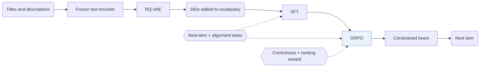

## At a Glance

Limitation: The scaling study measures training and evaluation losses as the model grows, not ranking metrics (Sec. 5.2, Fig. 1).

### 1. Why This Paper Matters

Industrial generative recommenders that replace embedding tables with Semantic ID (SID) sequences are mostly proprietary (Abstract). The authors ask whether scaling laws hold on public benchmarks and which post-training recipe is enough for competitive performance.

> "Yet most industrial deployments remain proprietary, leaving two fundamental questions open: (1) Do the expected scaling laws hold on public benchmarks? (2) What is the minimal post-training recipe that enables competitive performance?" (Abstract)

MiniOneRec answers with an open framework that covers SID construction, supervised fine-tuning (SFT), and reinforcement learning (RL), and releases code, training pipelines, and checkpoints (Sec. 1).

### 2. How It Works

#### Item Tokenization

A frozen text encoder embeds item titles and descriptions, and an RQ-VAE quantizes the embedding into a hierarchical SID (Sec. 3.2).

> "The codebooks, the encoder and the decoder are trained jointly, while the text encoder remains frozen." (Sec. 3.2)

#### Full-Process SID Alignment

The SID tokens are added to the LLM vocabulary. Next-item prediction and auxiliary alignment tasks, such as mapping between titles and SIDs, are optimized jointly in both the SFT stage and the RL stage (Sec. 3.3, Sec. 6).

#### Reinforced Preference Optimization

The RL stage uses GRPO with constrained beam search as the sampler, so every generated item is valid (Sec. 3.4.1). The default reward combines a binary correctness rule with a ranking term that penalizes hard negatives (Sec. 3.4.2).

> "The mixed reward discussed combines binary correctness with a soft ranking term, helping the LLM tell hard negatives apart." (Sec. 3.4.2)

### 3. Experimental Findings

- Scaling: training and evaluation losses decrease as the Qwen backbone grows from 0.5B to 7B parameters (Abstract, Sec. 5.2).
- Alignment: the variant that keeps SID alignment through the whole pipeline scores highest on every metric among the alignment variants (Sec. 5.5.1, Fig. 4a).
- Cross-domain: a model trained only on Industrial is applied to the unseen Office domain without further tuning (Sec. 5.4, Table 2).
- World knowledge: the paper compares pre-trained and randomly initialized backbones (Sec. 5.6, Table 3).

### 4. Limitations & Critical Analysis

**Our analysis.**

- LC-Rec also aligns a `Dec-Only` LLM to `RQ-VAE` SIDs with auxiliary tasks (`Multi-task NTP`); MiniOneRec keeps such tasks in a following RL stage (`NTP → RL`).
- OneRec builds SIDs from multimodal and collaborative signals (`MM+CF`) with `R-KM`; MiniOneRec uses text only (`Text`) with `RQ-VAE`.
