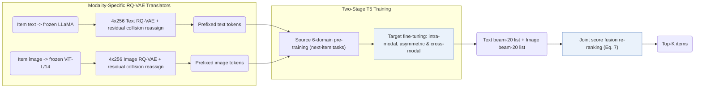

## At a Glance

Key Findings: Across Amazon Instruments, Arts, and Games under full-catalog ranking, MQL4GRec achieves the best overall accuracy—particularly on NDCG—and source-domain pre-training further lifts Instruments and Arts under dual modalities (Sec. 4.2, Sec. 4.3, Table 1).
Limitation: Dual-modality pre-training yields no gain on Games, and un-tuned zero-shot transfer to target domains remains weak (Sec. 4.3, Sec. 4.5).

### 1. Why This Paper Matters

Pre-trained language models carry general linguistic priors misaligned with collaborative patterns and rarely fuse item text with product images in a shared discrete space (Abstract). MQL4GRec translates multi-domain text and visual features into prefixed quantitative code vocabularies (`Dual RQ`), enabling cross-domain pre-training and multimodal list fusion.

> "Our key idea is to transform items from different domains and modalities into a unified language, which can serve as a bridge for transferring recommendation knowledge." (Abstract)

### 2. How It Works

#### Quantitative Translators

Frozen modality encoders—LLaMA for text and ViT for images—extract item embeddings that separate 4-level × 256 RQ-VAE translators quantize into modality-specific codebooks, resolving collisions via residual-to-codeword distances before prepending modality prefixes to form one shared dictionary (Sec. 3.1).

> "We train a quantitative translator for each modality, then add prefixes to the codewords from each of the two codebooks to form a dictionary." (Sec. 3.1)

#### Generation Tasks

Three task families link the two token streams: intra-modal next-item generation predicts the next item's tokens within text or vision; asymmetric generation predicts next-item image tokens from a text history or vice versa; and cross-modal alignment translates an item's text tokens into its image tokens and back (Sec. 3.2).

#### Pre-Training and Fine-Tuning

Pre-training across six source Amazon categories optimizes only the two intra-modal next-item tasks, whereas target-domain fine-tuning activates the full multi-task suite (Sec. 3.3). At inference, beam search decodes one candidate list per modality and merges both lists by fused item probabilities (Sec. 3.3, Eq. 7).

### 3. Experimental Findings

- Main comparison: across Instruments, Arts, and Games, MQL4GRec outperforms sequential, multimodal, and generative baselines on most metrics, with the largest margins on NDCG (Sec. 4.2, Table 1).
- Multi-domain pre-training: under dual modalities, source pre-training lifts accuracy on Instruments and Arts while leaving Games flat (Sec. 4.3).

  > "Under dual modalities, pre-training significantly improves performance on the Instruments and Arts datasets; however, it does not yield a notable improvement for the Games dataset, potentially due to overfitting." (Sec. 4.3)

- Zero-shot evaluation: evaluating the source-pretrained generator without target fine-tuning shows modest zero-shot signal on Instruments and Arts and none on Games (Sec. 4.5, Table 5).

### 4. Limitations & Critical Analysis

**Our analysis.**

- MQL4GRec trains its text and image RQ-VAEs independently (`Dual RQ`), coupling modalities only downstream in the generator; MACRec instead introduces cross-modal contrastive interaction directly inside quantization (`Cross RQ`).
- TIGER quantizes text alone (`Text`) and decodes a single `Beam` list; MQL4GRec quantizes `Text+Img` into separate prefixed streams and fuses dual modality beams (`Dual Beam`).
