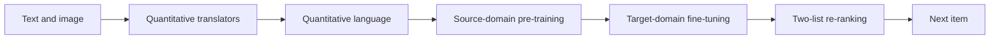

## At a Glance

Limitation: With both modalities, pre-training does not improve results on Games, and zero-shot ability on the target domains is weak (Sec. 4.3, Sec. 4.5).

### 1. Why This Paper Matters

Generative recommenders that build on pre-trained language models carry general linguistic knowledge that does not match recommendation needs, and they rarely use the complementary knowledge in item text and images (Abstract). MQL4GRec turns the content of items from many domains and modalities into one discrete vocabulary, so that a generator trained on source domains can transfer to a target domain.

> "Our key idea is to transform items from different domains and modalities into a unified language, which can serve as a bridge for transferring recommendation knowledge." (Abstract)

### 2. How It Works

#### Quantitative Translators

A frozen modal encoder, LLaMA for text or ViT for images, encodes item content (Sec. 3.1). An RQ-VAE per modality quantizes the representation, and each modality has its own codebooks.

> "We train a quantitative translator for each modality, then add prefixes to the codewords from each of the two codebooks to form a dictionary." (Sec. 3.1)

#### Generation Tasks

Next-item generation predicts the next item's quantitative language in the same modality. Asymmetric item generation predicts the image language from a text history, or the reverse (Sec. 3.2). Quantitative language alignment tasks map an item's text language to its image language and back.

#### Pre-Training and Fine-Tuning

Pre-training on the source domains uses only the two next-item generation sub-tasks. Fine-tuning on the target domain uses all generation tasks (Sec. 3.3).

At inference, the generator returns one recommendation list per modality, and a re-ranking step merges the two lists by their item scores (Sec. 3.3, Eq. 7).

### 3. Experimental Findings

- Main comparison: MQL4GRec performs best in most cases across Instruments, Arts, and Games, especially on NDCG (Sec. 4.2, Table 1).
- Pre-training: with both modalities, pre-training improves results on Instruments and Arts but not on Games.

  > "Under dual modalities, pre-training significantly improves performance on the Instruments and Arts datasets; however, it does not yield a notable improvement for the Games dataset, potentially due to overfitting." (Sec. 4.3)

- Zero-shot: pre-trained models without fine-tuning show preliminary but weak zero-shot ability on Instruments and Arts, and none on Games (Sec. 4.5, Table 5).

### 4. Limitations & Critical Analysis

**Our analysis.**

- The two quantizers are trained separately (`Dual RQ`), so the text and image codes are linked only by the generation tasks. MACRec replaces them with `Cross RQ`, which adds cross-modal contrastive learning inside quantization.
- TIGER quantizes text only (`Text`); MQL4GRec adds images (`Text+Img`) and keeps the same `Enc-Dec` generator with `Beam` decoding.
