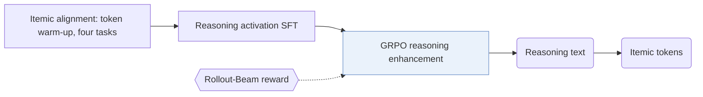
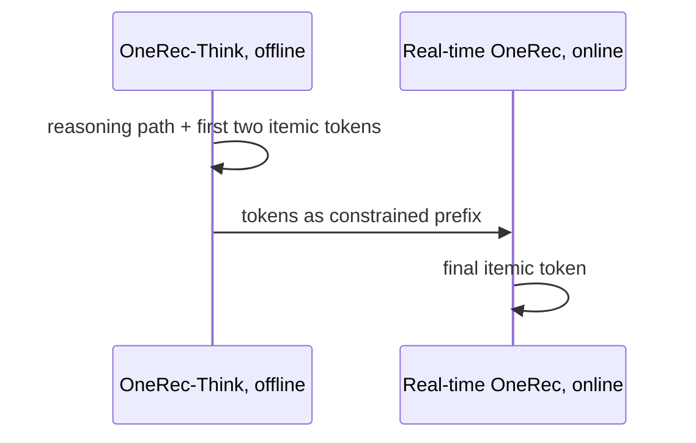

## At a Glance

Key Findings: In the online A/B test on Kuaishou, the Think-Ahead deployment increases App Stay Time by 0.159% against the online model (Sec. 5.4.2, Table 3).
Limitation: Multi-step reasoning conflicts with real-time latency requirements, so the full model runs only offline and a separate real-time OneRec model produces the last itemic token online (Sec. 4.4).

### 1. Why This Paper Matters

Generative recommenders such as OneRec predict item tokens directly and do not produce explicit, controllable reasoning (Abstract). OneRec-Think lets an LLM write a reasoning sequence and then the next itemic tokens in the same output.

> "In contrast, we reformulate this task to unify reasoning and recommendation in a single autoregressive pass." (Sec. 3)

### 2. How It Works

#### Itemic Alignment

Multi-task pre-training under next-token prediction teaches the LLM to read natural language and itemic tokens together (Sec. 4.1). The four tasks are interleaved user persona grounding, sequential preference modeling, itemic dense captioning, and general language modeling. A token warm-up substage first trains only the itemic token embeddings with the base LLM frozen, and then all parameters are trained jointly.

#### Reasoning Activation

Industrial behavior sequences are noisy. Supervised fine-tuning first extracts reasoning trajectories from pruned user contexts and then uses them to guide rationale generation over the raw behavior data (Sec. 4.2). The rationale and the target item are trained with a joint likelihood.

#### Reasoning Enhancement

RL with GRPO refines the reasoning paths (Sec. 4.3). After each sampled rationale, a constrained beam generates candidates, and the reward is the best position-wise match between a candidate and the target itemic tokens (Eq. 6).

> "To overcome this, we introduce the Rollout-Beam reward that evaluates reasoning capability by the model’s best achievable performance within a constrained beam." (Sec. 4.3)

#### Think-Ahead Serving

The full OneRec-Think model generates the reasoning path and the first two itemic tokens offline (Sec. 4.4).

> "It utilizes the pre-generated item-tokens as a constrained prefix to rapidly produce the final itemic token." (Sec. 4.4)

### 3. Experimental Findings

- Public benchmarks: OneRec-Think performs best on Amazon Beauty, Toys, and Sports against the baselines in Table 1 (Sec. 5.2).
- Ablation: on Beauty, adding itemic alignment to the base model and then the reasoning mechanism both improve the recommendation metrics (Sec. 5.3, Table 2).

### 4. Limitations & Critical Analysis

**Our analysis.**

- OneRec uses an `Enc-Dec` generator trained with `NTP → DPO`; OneRec-Think uses a `Dec-Only` LLM trained with `NTP → RL` and generates reasoning before the item (`CoT`).
- The online gain comes from a split system in which a different model produces the last token. This suggests that the measured effect mixes the offline reasoning with the online model's own updates.
