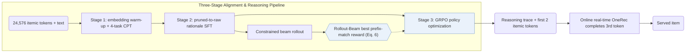
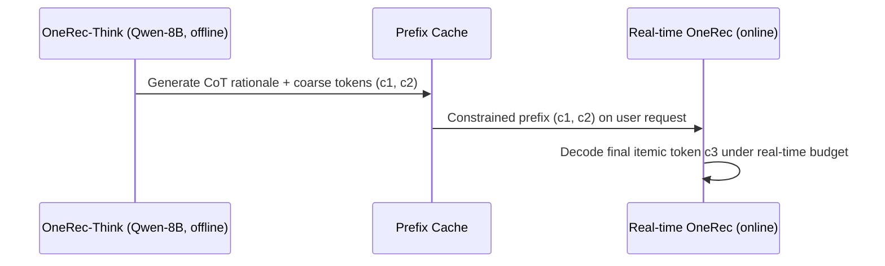

## At a Glance

Key Findings: In Kuaishou's online A/B test, Think-Ahead deployment raises App Stay Time by 0.159% over the production baseline while outperforming sequential and generative baselines on Amazon Beauty, Toys, and Sports (Sec. 5.2, Sec. 5.4.2, Tables 1 and 3).
Limitation: Autoregressive chain-of-thought reasoning exceeds strict online latency budgets, forcing the full model to pre-compute prefixes offline while a separate real-time OneRec model completes the final token online (Sec. 4.4).

### 1. Why This Paper Matters

Direct SID generators such as OneRec emit item tokens without explicit intermediate reasoning, limiting interpretability and multi-step intent deduction (Abstract). OneRec-Think unifies natural-language chain-of-thought generation and hierarchical itemic token decoding inside a single autoregressive pass, paired with a split offline-online serving architecture.

> "In contrast, we reformulate this task to unify reasoning and recommendation in a single autoregressive pass." (Sec. 3)

### 2. How It Works

#### Itemic Alignment

Next-token continued pre-training bridges natural language and discrete itemic tokens across four tasks: interleaved user persona grounding, sequential preference modeling, itemic dense captioning, and general language modeling (Sec. 4.1). A token warm-up substage first updates only the new itemic embeddings with the LLM backbone frozen before unfreezing all parameters jointly.

#### Reasoning Activation

Because raw industrial interaction logs contain noisy clicks, supervised fine-tuning distills clean reasoning trajectories from pruned user histories and transfers them to supervise joint rationale-and-item likelihood over raw behavior sequences (Sec. 4.2).

#### Reasoning Enhancement

GRPO reinforcement learning refines the generated rationales (Sec. 4.3). Conditioned on each sampled reasoning trace, constrained beam search rolls out candidate SIDs and scores the trace by the highest position-wise token match achieved within the beam against the ground-truth item (Eq. 6).

> "To overcome this, we introduce the Rollout-Beam reward that evaluates reasoning capability by the model’s best achievable performance within a constrained beam." (Sec. 4.3)

#### Think-Ahead Serving

To meet production latency limits, the full OneRec-Think LLM runs asynchronously offline to generate the reasoning trace and the coarse first two itemic tokens, passing those prefixes to an online OneRec model that decodes the final fine-grained token in real time (Sec. 4.4).

> "It utilizes the pre-generated item-tokens as a constrained prefix to rapidly produce the final itemic token." (Sec. 4.4)

### 3. Experimental Findings

- Public benchmarks: on Amazon Beauty, Toys, and Sports, OneRec-Think outperforms sequential and generative baselines across all Table 1 metrics (Sec. 5.2, Table 1).
- Stage-wise ablation: on Beauty, adding four-task itemic alignment to the base LLM and subsequently enabling chain-of-thought reasoning + Rollout-Beam RL each yield monotonic ranking gains (Sec. 5.3, Table 2).

### 4. Limitations & Critical Analysis

**Our analysis.**

- OneRec trains a sparse-MoE `Enc-Dec` generator via `NTP → DPO` to emit sessions directly; OneRec-Think adapts a `Dec-Only` LLM via `NTP → RL` to emit natural-language `CoT` before the SID.
- Because Think-Ahead serving delegates the final token to a separate online model, the online A/B lift reflects the joint system of offline coarse prefixing plus online real-time completion rather than standalone end-to-end LLM serving.
