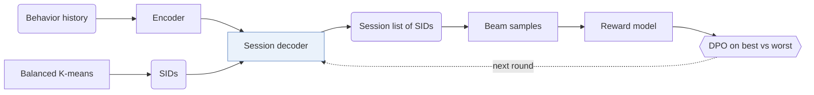

## At a Glance

Limitation: In the online test, OneRec improves watch time but is weaker on interaction indicators such as likes (Sec. 6).

### 1. Why This Paper Matters

Most recommenders run a retrieve-and-rank cascade, and a generative model, when present, only selects candidates in the retrieval stage (Abstract). The authors argue that each stage caps the stage after it.

> "existing methods typically treat each ranker independently, where the effectiveness of each isolated stage serves as the upper bound for the subsequent ranking stage, thereby limiting the performance of the overall ranking system." (Sec. 1)

OneRec replaces the cascade with a single-stage generative model and was deployed in the main scene of Kuaishou (Abstract, Sec. 1).

### 2. How It Works

#### Balanced Semantic IDs

Each item receives a Semantic ID (SID) from balanced K-means, in which every cluster holds the same number of items (Sec. 3.1, Algorithm 1).

#### Session-Wise List Generation

Instead of predicting one next item, OneRec generates the list of items for a whole session and considers the content and order of items within it (Sec. 1). An encoder models the user's history, and a decoder generates the session list (Sec. 3.2).

> "The decoder takes the semantic IDs of the target session as input and generates the target in an auto-regressive manner." (Sec. 3.2)

#### Iterative Preference Alignment

A recommender shows each request only once, so true positive and negative lists for the same request are not available (Abstract). OneRec samples several responses with beam search, scores them with a pre-trained reward model, and pairs the highest-scoring and lowest-scoring responses for DPO (Sec. 3.3.2). The model then generates new samples in the next round.

### 3. Experimental Findings

- Session-wise generation: OneRec outperforms dot-product retrieval methods and point-wise generation such as TIGER on the reward-model metrics (Sec. 5.2, Table 1).
- Preference alignment: adding IPA further improves the generated sessions (Sec. 5.2, Table 1).

### 4. Limitations & Critical Analysis

**Stated by the authors.**

> "Additionally, our analysis of online results reveals that, besides user watch time, our model has limitations in interactive indicators, such as likes." (Sec. 6)

**Our analysis.**

- The DPO pairs are ranked by the reward model, not by observed user feedback on both lists. This suggests that alignment quality is bounded by the reward model.
- MiniOneRec reproduces the pipeline on public data with `RQ-VAE` SIDs over text only (`Text`), a `Dec-Only` generator, and RL in place of DPO (`NTP → RL`).
