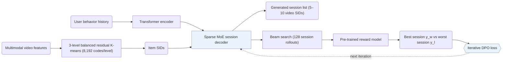

## At a Glance

Key Findings: OneRec outperforms dot-product retrieval and pointwise generators such as TIGER on offline reward-model metrics (Table 1), and OneRec-1B+IPA reports +1.68% total watch time and +6.56% average view duration in online A/B testing on Kuaishou (Table 2).
Limitation: In the online test, OneRec improves watch time but is weaker on interaction indicators such as likes (Sec. 6).

### 1. Why This Paper Matters

Most industrial recommenders run a multi-stage retrieve-and-rank cascade where each stage caps the candidates available to the next, and existing generative models act only as candidate selectors in the retrieval stage.

> "existing methods typically treat each ranker independently, where the effectiveness of each isolated stage serves as the upper bound for the subsequent ranking stage, thereby limiting the performance of the overall ranking system." (Sec. 1)

OneRec replaces the cascade with a single-stage generative model deployed in the main scene of Kuaishou (Abstract, Sec. 1).

### 2. How It Works

#### Balanced Semantic IDs

Each video receives a 3-level Semantic ID (SID) with 8,192 codes per level from multi-level balanced residual K-means over behavior-aligned multimodal embeddings, where every cluster holds the same number of items (Sec. 3.1, Algorithm 1).

#### Session-Wise List Generation

Instead of predicting a single next item, OneRec generates the 5–10 item list for a full session and models both the content and ordering of items within the session (Sec. 1). A Transformer encoder encodes the user's interaction history, and a sparse MoE decoder generates the target session SIDs autoregressively (Sec. 3.2).

> "The decoder takes the semantic IDs of the target session as input and generates the target in an auto-regressive manner." (Sec. 3.2)

#### Iterative Preference Alignment

Because a recommender serves only one list per request, ground-truth positive and negative session lists for the same request are not observable in logs. OneRec samples 128 candidate sessions per user via beam search, scores them with a pre-trained reward model, and pairs the highest-scoring and lowest-scoring responses for DPO training (Sec. 3.3.2). The updated generator then samples new preference pairs in the next round.

### 3. Experimental Findings

- Session-wise generation: OneRec outperforms dot-product retrieval baselines and pointwise generators such as TIGER on offline reward-model metrics across session watch time and interaction probabilities (Sec. 5.2, Table 1).
- Preference alignment: adding iterative preference alignment (IPA) further improves offline session reward scores (Sec. 5.2, Table 1, Fig. 4) and yields +1.68% total watch time and +6.56% average view duration for OneRec-1B+IPA in online A/B testing on Kuaishou (Table 2).

### 4. Limitations & Critical Analysis

**Stated by the authors.**

> "Additionally, our analysis of online results reveals that, besides user watch time, our model has limitations in interactive indicators, such as likes." (Sec. 6)

**Our analysis.**

- The DPO pairs are ranked by a pre-trained reward model rather than observed user feedback on competing lists, so alignment quality is bounded by the reward model's fidelity across multiple objectives.
- MiniOneRec reproduces the pipeline on public data with `RQ-VAE` SIDs over text only (`Text`), a `Dec-Only` generator, and RL in place of DPO (`NTP → RL`).
