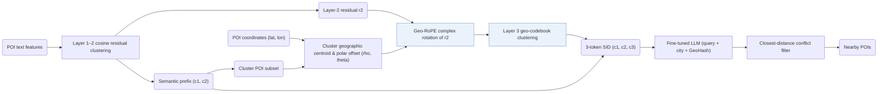

## At a Glance

Key Findings: On the industrial dataset, ProGEO reports Hit@50 of 0.4243 against 0.4056 for RQ-Kmeans, and an average geographic clustering distance of 25.41 km against 46.71 km for RQ-OPQ (Table 1).
Limitation: Geographic encoding enters only at the third quantization layer, and resolving SID collisions by closest user distance requires real-time user coordinates that are unavailable on the public Foursquare benchmarks (Sec. 3.3, Table 3).

### 1. Why This Paper Matters

Local service platforms require recommendations that are both semantically relevant and geographically reachable, whereas standard semantic codebooks cluster items by content alone.

> "existing semantic codebooks neglect geographic constraints, often resulting in recommendations that are semantically relevant yet geographically unreachable." (Abstract)

ProGEO retains standard semantic codewords in the first two layers and appends a third-layer geo-codeword that encodes each POI's spatial offset relative to its semantic cluster, integrating geography directly into the Semantic ID (SID) rather than treating location as a weak auxiliary feature (Sec. 1).

### 2. How It Works

#### Semantic Layers

The first two codebook layers cluster mixed feature vectors using cosine similarity and pass the projection residual $`\mathbf{r}_2`$ to the next layer (Sec. 3.1). The resulting SID consists of two standard semantic codebook layers followed by one geo-codebook layer (Fig. 2).

#### Geo-Centroid Local Coordinates

All POIs that share the same two-layer semantic prefix $`(c_1, c_2)`$ form a semantic cluster subset. The latitudes and longitudes of these POIs define the cluster's geographic centroid, and each POI's global coordinates are converted into local polar coordinates $`(\rho, \theta)`$ around that centroid (Sec. 1, Sec. 3.2).

#### Geo-RoPE

Geo-RoPE encodes each POI's polar offset from its cluster centroid as a complex-valued rotation applied to the second-layer semantic residual $`\mathbf{r}_2`$ before third-layer clustering (Sec. 1, Sec. 3.3). Cosine similarity between two rotated residuals therefore reflects both semantic similarity and spatial proximity.

> "We extend RoPE to the spatial domain, formalizing geographic proximity as rotary operations in high-dimensional feature space." (Sec. 3.3)

#### Generation

In the industrial setting, the fine-tuned LLM prompt takes the search query, the city name, and a GeoHash of the user's real-time location (Table 4), and resolves SID collisions by selecting the candidate POIs closest to the user (Table 3).

### 3. Experimental Findings

- Geo-RoPE layer placement: applying Geo-RoPE only at the third clustering layer achieves the highest codebook usage rate (CUR = 7.67%) and independent coding rate (ICR = 57.08%) among the tested layer placements (Sec. 4.3.2, Fig. 5).
- Spatial reachability case study: adding Geo-RoPE concentrates recommended POIs near the user, whereas removing it can return a semantically similar POI in another city (Sec. 4.5.2).

  > "when Geo-RoPE is introduced, the recommended POIs are concentrated much closer to the user, typically within a 6-kilometer radius." (Sec. 4.5.2)

### 4. Limitations & Critical Analysis

**Our analysis.**

- The geographic signal enters only the third SID token, so the generator commits to a two-layer semantic cluster before conditioning on any spatial cue inside the SID.
- OneLoc uses plain `R-KM` codes; ProGEO adds a dedicated geo-codebook layer to the same residual K-means tokenizer family (`R-KM+Geo-CB`).
- GNPR-SID also encodes geography in POI SIDs (`Attr+Geo+CF`) but quantizes fused features with a plain `RQ-VAE` rather than a spatial rotation layer.
