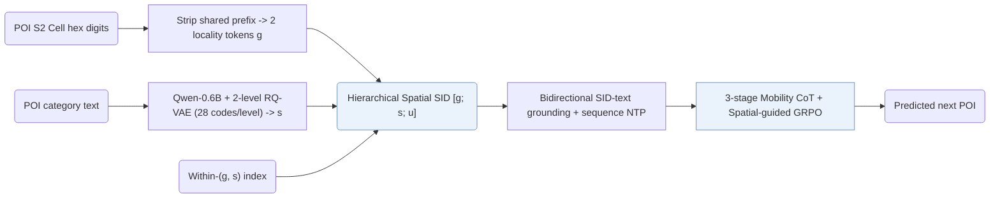
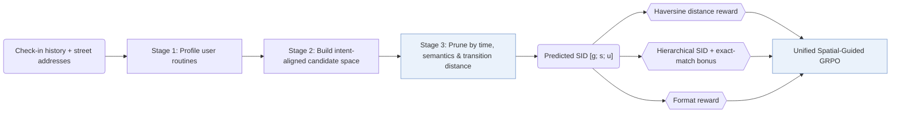

## At a Glance

Key Findings: On NYC, ROS reports HR@1 of 0.4478 against 0.4027 for CoAST (+11.2%), and the paper reports gains of +11.0% on TKY and +15.7% on Gowalla-CA over the strongest LLM-based baselines (Table 1).
Limitation: A monotonic prior treats long moves within short intervals as unlikely, so ROS can underweight fast trips by metro rail or highway, especially near transit hubs (Limitations).

### 1. Why This Paper Matters

LLM-based generative recommenders make limited use of geographic structure, which governs feasibility in human mobility and local-service scenarios. ROS formulates the next visit as a sequence of constrained decisions driven by time, intent, and geography (Sec. 2.3), representing each POI with a hierarchical spatial Semantic ID (SID) `[g; s; u]` that jointly encodes locality and POI category semantics (Abstract).

> "We present ROS, a generative next POI recommendation framework that treats geography as an explicit decision variable." (Sec. 5)

### 2. How It Works

#### Hierarchical Spatial SID

Each POI SID concatenates a geospatial prefix `g`, a semantic anchor `s`, and a discriminative suffix `u` (Sec. 2.2.1). The prefix converts the POI's S2 Cell ID into hexadecimal digits, strips the prefix shared across the city catalog, and groups the remaining digits into two locality tokens. The semantic anchor embeds the POI's category description with Qwen-0.6B and quantizes it with a 2-level RQ-VAE of 28 codes per level, followed by a sequential suffix `u` within each `(g, s)` pair.

#### SID Grounding

Bidirectional alignment trains the LLM both to predict the spatial SID from textual POI descriptions and to generate descriptions from the SID (Sec. 2.2.2).

> "This bidirectional alignment grounds SID tokens in functional semantics and fine-grained neighborhood cues." (Sec. 2.2.2)

Sequence pretraining then trains next-POI prediction over SID trajectories so the backbone captures recency, category repetition, and neighborhood continuity.

#### Mobility Chain-of-Thought

Before emitting the target SID, the generator executes three deterministic reasoning stages: profiling the user's mobility habits, constructing an intent-aligned candidate space, and pruning candidates by temporal consistency, semantic fit, and spatial reachability inferred from street addresses and transition distances (Sec. 2.3).

#### Spatial-Guided RL

GRPO optimizes the reasoning-and-generation policy under a unified composite reward (Sec. 2.4.3) that combines a monotonic Haversine distance decay between the predicted and ground-truth POI coordinates (Sec. 2.4.1), a hierarchical SID prefix match with an exact-match bonus (Sec. 2.4.2), and a reasoning format check.

### 3. Experimental Findings

- CoT stage ablation: retaining all three Mobility CoT stages jointly yields the highest HR@1, whereas dropping user profiling, candidate construction, or spatial pruning degrades accuracy across datasets (Sec. 3.3, Table 3).
- Cross-city transfer: trained on one city and evaluated zero-shot on two unseen cities, ROS outperforms LLM4POI and GA-LLM on all transfer pairs (Sec. 3.4, Table 6).

### 4. Limitations & Critical Analysis

**Our analysis.**

- GNPR-SID quantizes POI features with a plain `RQ-VAE`; ROS prepends explicit S2-cell locality tokens before the semantic codes (`Geo-Prefix+RQ-VAE`).
- SpaceTime-GR uses geographic indices only (`Geo`, `Geo-Idx`); ROS combines S2 locality prefixes with category `RQ-VAE` codes and structured spatio-temporal reasoning before constrained decoding (`CoT+C-Beam`).
