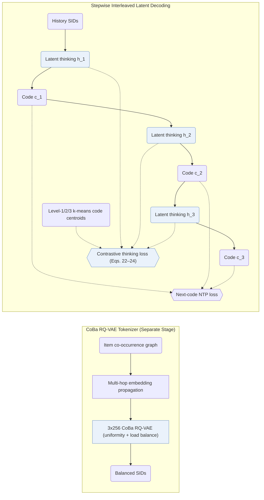

## At a Glance

Key Findings: S2GR achieves an independent coding rate of 99.30% on Beauty and 76.25% on an industrial short-video catalog while outperforming sequential, reasoning, and TIGER baselines offline and lifting online A/B performance against TIGER (Abstract, Sec. 5.3, Sec. 5.4, Tables 2–4).
Limitation: On the industrial dataset with matched model scale, interleaved latent thinking raises training time from about 45 h (TIGER) to about 59 h and total inference time from about 0.88 h to about 0.90 h (Appendix B.1, Table B.1).

### 1. Why This Paper Matters

Standard generative recommenders emit Semantic IDs (SIDs) directly without intermediate reasoning, whereas text-first CoT variants concentrate all reasoning compute before the first code and latent-reasoning variants lack grounded supervision (Abstract, Sec. 1). S2GR interleaves one continuous thinking vector immediately before each SID code level and supervises each vector against the k-means cluster centroid of the upcoming ground-truth code.

### 2. How It Works

#### Behavior-Aligned Codebook

S2GR constructs an item co-occurrence graph from training histories and smooths pretrained text embeddings across multi-hop neighbors prior to quantization (Sec. 4.2.1).

> "This encodes essential collaborative patterns without requiring additional model training." (Sec. 4.2.1)

A codebook-balanced RQ-VAE (`CoBa RQ-VAE`) then quantizes the smoothed representations under uniformity constraints and adaptive load balancing, trained separately before the generator (Sec. 4.2, Sec. 4.2.2).

#### Stepwise Latent Thinking

Before emitting each discrete SID code, the encoder-decoder generator outputs a continuous latent thinking embedding rather than natural-language tokens (Sec. 4.3.2). A contrastive thinking loss pulls each thinking vector toward the k-means centroid of the next ground-truth code in the corresponding level's codebook, optimized jointly with next-token recommendation cross-entropy (Eqs. 22–24).

#### Decoding

During beam search, each beam deterministically emits the continuous thinking vector and then branches only on the discrete SID code, avoiding beam fragmentation on latent steps (Appendix B.1).

> "For inference, the increase in latency is relatively small." (Appendix B.1)

### 3. Experimental Findings

- Component ablations: dropping either the interleaved thinking vectors or the centroid-aligned contrastive loss consistently degrades ranking accuracy on both Amazon Beauty and the industrial short-video dataset (Sec. 5.3, Table 2).
- Online deployment: a 7-day online A/B test on a short-video platform against a matched TIGER control confirms statistically consistent live gains for S2GR (Abstract, Sec. 5.4, Table 4).

### 4. Limitations & Critical Analysis

**Our analysis.**

- TIGER pairs text-only `RQ-VAE` codes (`Text`) with plain `NTP`; S2GR smooths item embeddings over a co-occurrence graph (`Text+CF`, `CoBa RQ-VAE`) and supervises interleaved latent states via `NTP + Ctr.`.
- OneRec-Think generates variable-length natural-language `CoT` with a `Dec-Only` LLM; S2GR retains a compact `Enc-Dec` backbone under standard `Beam` search by reasoning one continuous vector per code level.
