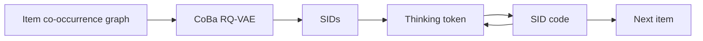

## At a Glance

Limitation: On the industrial dataset with same-scale models, training takes about 59 h against about 45 h for TIGER, while total inference rises from about 0.88 h to about 0.90 h (Appendix B.1, Table B.1).

### 1. Why This Paper Matters

Most generative recommenders generate Semantic IDs (SIDs) directly from interaction sequences without a reasoning step (Abstract). The authors name two problems in reasoning-enhanced variants: reasoning placed entirely before generation spreads computation unevenly across the SID levels, and latent reasoning vectors have no interpretable semantics or verifiable supervision. S2GR interleaves thinking tokens with SID code generation, one before each code, and supervises each with the semantics of the next code (Sec. 1).

### 2. How It Works

#### Behavior-Aligned Codebook

S2GR builds an item co-occurrence graph from history sequences and propagates item embeddings over it (Sec. 4.2.1).

> "This encodes essential collaborative patterns without requiring additional model training." (Sec. 4.2.1)

The codebook-balanced RQ-VAE adds uniformity constraints and adaptive load balancing to the quantizer (Sec. 4.2.2).

#### Stepwise Latent Thinking

Before each SID code, the generator outputs a thinking token, which is a continuous latent embedding rather than natural-language text (Sec. 4.3.2). A contrastive loss aligns it with the k-means cluster centroid of the next ground-truth code in the corresponding codebook. The generator objective adds this thinking loss to the recommendation loss (Eqs. 22–24). The tokenizer is optimized separately (Sec. 4.2).

#### Decoding

Each beam produces the thinking token and its following SID code in one continuous step, so thinking tokens do not expand the beam (Appendix B.1).

> "For inference, the increase in latency is relatively small." (Appendix B.1)

### 3. Experimental Findings

- Ablation: removing the stepwise reasoning tokens or the thinking loss degrades performance on Beauty and on the industrial dataset (Sec. 5.3, Table 2).
- Online A/B test: the authors report that the test on a large-scale short-video platform, with TIGER as the control, confirms the efficacy of S2GR (Abstract, Sec. 5.4, Table 4).

### 4. Limitations & Critical Analysis

**Our analysis.**

- TIGER uses text-only `RQ-VAE` codes (`Text`) and plain `NTP`; S2GR adds collaborative signals to the tokenizer (`Text+CF`, `CoBa RQ-VAE`) and a contrastive term to the generator (`NTP + Ctr.`).
- OneRec-Think reasons in text with a `Dec-Only` LLM (`CoT`); S2GR keeps an `Enc-Dec` generator with `Beam` decoding and reasons in latent tokens.
