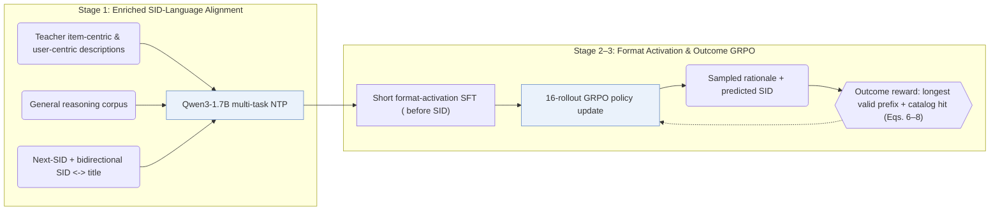

## At a Glance

Key Findings: Enriching multi-task SID–language alignment with teacher-synthesized descriptions and mixing general reasoning corpora lifts full-catalog accuracy across Amazon Games, Office, and Industrial both before and after GRPO reinforcement learning (Tables 2 and 3).
Limitation: Outcome-based GRPO scores only the terminal Semantic ID—by longest matching prefix and catalog validity—without directly supervising the intermediate reasoning text (Sec. 3.3.2).

### 1. Why This Paper Matters

Even when Semantic IDs (SIDs) share one vocabulary with text tokens, large language models (LLMs) struggle to reason over opaque discrete codes while high-quality recommendation rationales remain scarce (Abstract). SIDReasoner invests first in dense bidirectional SID–language grounding mixed with general reasoning corpora, allowing general LLM deduction to transfer to recommendation under lightweight outcome-only RL.

> "Stronger SID–language alignment can help general reasoning abilities better generalize to recommendation tasks." (Sec. 5)

### 2. How It Works

#### SID-Language Alignment

Multi-task continued training combines sequential next-SID prediction with bidirectional translation between SIDs and item titles (Sec. 3.2.2). A teacher LLM expands raw metadata into both item-centric and user-centric descriptions, co-trained alongside general-domain reasoning data so new SID embeddings remain anchored to the LLM's reasoning subspace (Sec. 3.2.3).

#### Reasoning Activation

A brief supervised "cold-start reasoning activation" step trains the model to emit a structured `<think>` rationale prior to the target SID—stabilizing output formatting rather than addressing cold-start users or items (Sec. 3.3.1).

> "This stage mainly serves to improve the reliability of response formatting, ensuring that reasoning is consistently generated before recommendation." (Sec. 3.3.1)

#### Outcome-Based GRPO

Group Relative Policy Optimization (GRPO) samples 16 reasoning-plus-SID trajectories per user prompt and updates the policy using outcome rewards defined solely on prefix-match depth and catalog validity of the predicted SID (Sec. 3.3.2, Eqs. 6–8).

### 3. Experimental Findings

- Alignment ablations: adding teacher-enriched descriptions and general reasoning data to multi-task alignment consistently boosts full-catalog accuracy both immediately after alignment and after subsequent GRPO (Table 3).
- Cross-domain reasoning transfer: after joint multi-domain SID–language alignment, applying GRPO on a single domain already transfers reasoning gains to the remaining unseen-RL domains, approaching full multi-domain RL (Sec. 4.2.2, Fig. 3).

  > "Such reasoning knowledge, once learned, can be transferred across domains." (Sec. 4.2.2)

- Concise rationales: generated reasoning traces shorten naturally over GRPO training iterations without accuracy loss (Sec. 4.4.2, Fig. 6).

### 4. Limitations & Critical Analysis

**Our analysis.**

- LC-Rec stops after `Multi-task NTP` instruction alignment on a `Dec-Only` LLM; SIDReasoner couples teacher-enriched alignment with format activation and outcome-driven `NTP → RL` (`CoT`).
- TIGER decodes `RQ-VAE` SIDs directly with a small `Enc-Dec` Transformer under `NTP`; SIDReasoner feeds `RQ-VAE` tokens into Qwen3-1.7B and elicits natural-language reasoning before emitting the SID.
