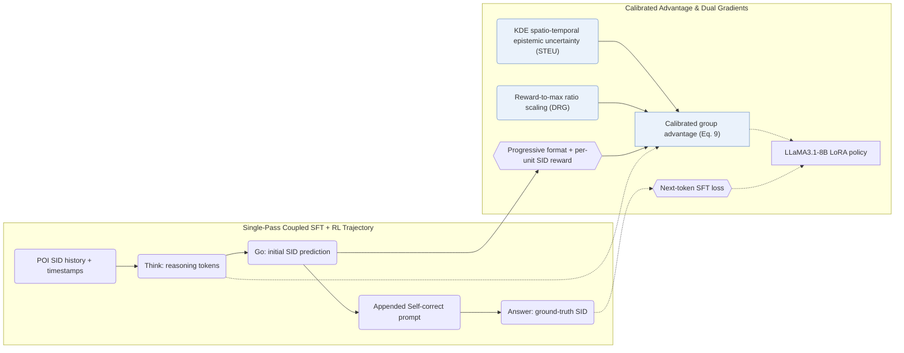

## At a Glance

Key Findings: Across Foursquare NYC, TKY, and Gowalla CA, Think2Go outperforms sequential, graph, LLM, and reasoning POI baselines while improving 10-way SID category identification over GNPR and curbing cross-city out-of-domain drop (Sec. 5.5–5.8, Tables 2–5).
Limitation: Prompts contain only discrete POI Semantic IDs and timestamps without raw textual names or coordinates, relying entirely on RQ-VAE codes and KDE uncertainty weights to carry spatial context (Sec. 4.2.1, Appendix E).

### 1. Why This Paper Matters

Next-POI mobility trajectories are sparse and noisy, yet non-reasoning generators miss multi-step intent transitions while separately trained Semantic IDs (SIDs) remain opaque to pretrained LLMs (Abstract, Sec. 5.8). Think2Go unifies supervised memorization and reinforcement-learning exploration inside a single `Think -> Go -> Self-correct -> Answer` pass and calibrates group advantages by spatial-temporal epistemic uncertainty and relative reward scale (Sec. 4, Sec. 4.1).

### 2. How It Works

#### Unified SFT and RL

Model inputs consist solely of listwise RQ-VAE POI SIDs and timestamps (Appendix E). Each training sequence concatenates the model's sampled reasoning (`Think`) and first prediction (`Go`) with a fixed self-correction prompt and the ground-truth POI (`Answer`), routing RL policy gradients through the reasoning trace and SFT cross-entropy through the appended answer (Sec. 4.1, Table 7).

> "This forms a Think–>Go–>Self–correct–>Answer structure, where tokens from the reasoning trace are used for RL, and tokens from the appended answer are used for SFT." (Sec. 4.1)

#### Progressive Reward

The RL reward transitions from syntax formatting validity to decomposed unit-by-unit SID match accuracy across hierarchical code levels (Sec. 4.2.2).

#### Calibrated Advantage

Standard group-relative advantages weight easy routine check-ins and novel mobility queries equally (Sec. 4.2.3). Think2Go modulates updates with two factors: kernel density estimation (KDE) over the user's spatial-temporal history measures query epistemic uncertainty (STEU) to amplify updates on correct hard predictions while damping wrong ones (Sec. 4.2.1, Sec. 6), and dynamic reward-guided scaling (DRG) multiplies group advantages by the ratio to the maximum reward so absolute quality signals survive group normalization, acting as an implicit curriculum (Sec. 4.2.4, Eq. 9).

> "challenging samples with high epistemic uncertainty and correct predictions receive larger updates to encourage exploration, while incorrect predictions are updated conservatively to ensure robustness." (Sec. 4.2.1)

### 3. Experimental Findings

- Component ablations and exploration entropy: removing reasoning tokens, STEU uncertainty weighting, DRG reward scaling, or the token entropy bonus each lowers accuracy across NYC, TKY, and CA (Sec. 5.5, Table 3), while DRG prevents reasoning-token entropy collapse during RL training (Sec. 4.2.4, Sec. 5.6, Fig. 3).

  > "Through comparative experiments, we further observe that it effectively alleviates entropy collapse by maintaining a high entropy level for the reasoning tokens, which implies greater exploration capacity." (Sec. 4.2.4)

- SID semantic probing and cross-city transfer: on 1-shot 10-way POI category classification from a bare SID (Appendix C.2, Table 8), Think2Go surpasses GNPR (Sec. 5.7, Table 4), degrades less under cross-city out-of-domain evaluation (Sec. 5.8, Table 5), and reports competitive per-epoch training time, test latency, and GPU memory against Refine-POI on NYC (Appendix E, Table 10).

### 4. Limitations & Critical Analysis

**Our analysis.**

- GNPR-SID trains on `RQ-VAE` POI SIDs with `NTP` alone without reporting its decoding rule (`–`); Think2Go couples SFT with uncertainty-calibrated RL (`NTP → RL`) and decodes via `CoT+Beam`.
- ROS embeds geographic prefixes directly inside the identifier (`Geo-Prefix+RQ-VAE`) under `CoT+C-Beam`; Think2Go retains a pure `RQ-VAE` SID and injects spatio-temporal density into the RL advantage weights instead.
