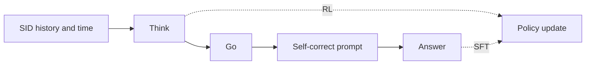

### 1. Why This Paper Matters

Next-POI recommendation learns from sparse and complex mobility patterns (Abstract). The authors argue that non-reasoning models lack the capacity to capture deep intent from them, and that LLMs understand Semantic IDs (SIDs) poorly when the SIDs are trained separately from the model (Abstract, Sec. 5.8). Think2Go lets an LLM reason before it recommends, and trains memorization and reasoning in one architecture instead of running SFT and RL one after the other (Sec. 4, Sec. 4.1).

### 2. How It Works

#### Unified SFT and RL

The model input contains SIDs and temporal information only (Appendix E). During training, the model reasons and makes a first prediction, then a fixed self-correct prompt is appended, followed by the correct answer (Sec. 4.1, Table 7).

> "This forms a Think–>Go–>Self–correct–>Answer structure, where tokens from the reasoning trace are used for RL, and tokens from the appended answer are used for SFT." (Sec. 4.1)

#### Progressive Reward

The reward first favors well-formatted responses and then semantically correct answers (Sec. 4.2.2). Correctness is scored on the decomposed SID units.

#### Calibrated Advantage

Standard group advantages give the same update weight to easy and hard samples (Sec. 4.2.3). Think2Go adds two weights. Kernel density estimation measures how well the query matches the user's spatial-temporal history, and this epistemic uncertainty changes the update size (Sec. 4.2.1, Sec. 6).

> "challenging samples with high epistemic uncertainty and correct predictions receive larger updates to encourage exploration, while incorrect predictions are updated conservatively to ensure robustness." (Sec. 4.2.1)

The second weight rescales the group advantage by the reward relative to the maximum reward, so that the absolute performance signal is kept (Sec. 4.2.4, Eq. 9). The authors describe the combination as an implicit curriculum.

### 3. Experimental Findings

- Ablation: Table 3 removes the reasoning tokens, the epistemic-uncertainty weight (STEU), the reward-informed weight (DRG), and a token entropy bonus (Sec. 5.5).
- Entropy: the reward-informed scaling keeps the entropy of reasoning tokens high during training (Sec. 4.2.4, Sec. 5.6, Fig. 3).

  > "Through comparative experiments, we further observe that it effectively alleviates entropy collapse by maintaining a high entropy level for the reasoning tokens, which implies greater exploration capacity." (Sec. 4.2.4)

- SID understanding: given a SID and ten candidate categories, the model identifies the correct category, compared against GNPR (Sec. 5.7, Table 4). The prompt for this task includes one example (Appendix C.2, Table 8).
- Out-of-domain: Think2Go degrades less than the other methods on out-of-domain datasets (Sec. 5.8, Table 5).
- Efficiency: against Refine-POI trained on NYC, the paper reports training time per epoch, test time, and memory (Appendix E, Table 10).

### 4. Limitations & Critical Analysis

**Our analysis.**

- GNPR-SID trains on `RQ-VAE` POI SIDs with `NTP` only and has no reported inference strategy (`–`); Think2Go adds an RL stage (`NTP → RL`) and reasons before decoding (`CoT+Beam`).
- ROS also reasons before decoding (`CoT+C-Beam`) but puts geography into the SID itself (`Geo-Prefix+RQ-VAE`); Think2Go keeps a plain `RQ-VAE` SID and models space through the advantage weights.
