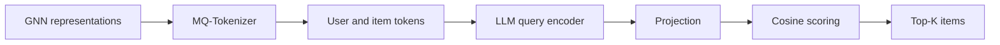

## At a Glance

Limitation: New users and items need a retrained collaborative filtering model to produce their representations; only the tokenizer and the LLM stay frozen (Sec. II-E.2).

### 1. Why This Paper Matters

LLM-based recommenders need user and item tokens that the LLM can read (Abstract). One token per user or item expands the LLM vocabulary with the number of users and items (Sec. I). The authors also name two further gaps: existing tokens do not capture high-order collaborative knowledge, and they generalize poorly to users or items outside the training data (Abstract). TokenRec tokenizes users and items from collaborative representations and replaces autoregressive decoding with retrieval.

Based on arXiv v3.

### 2. How It Works

#### MQ-Tokenizer

A GNN-based collaborative filtering model learns user and item representations, which are stored in a vector database (Sec. II-C.2).

> "Specifically, our MQ-Tokenizer assigns each user and item a small number of discrete tokens generated by quantizing the GNN-based representations." (Sec. II-C.1)

The tokenizer randomly masks the representation, encodes it with K separate encoders, and quantizes each output against its own codebook (Sec. II-C.2, Sec. II-C.3). The decoder averages the K codewords and reconstructs the collaborative representation with an MLP (Sec. II-C.4, Eq. 9). User and item tokenizers are trained separately.

> "we propose to randomly mask these representations to create a challenging task that enables the tokenizer to build a comprehensive understanding and generalize well." (Sec. II-C.2)

#### Generative Retrieval

The LLM reads a prompt with the user's tokens and, optionally, the tokens of interacted items, which are shuffled during training rather than kept in time order (Sec. II-D.2). The LLM acts as a query encoder. A three-layer MLP projects its hidden state, and cosine similarity against the GNN item representations scores all items for top-K retrieval (Sec. II-D.3, Eqs. 17–19).

### 3. Experimental Findings

- Main comparison: TokenRec outperforms both traditional and LLM-based recommenders on the four datasets (Abstract, Tables 2 and 3).
- Inference time: the authors attribute the speed to retrieval instead of decoding.

  > "This can be attributed to our generative retrieval paradigm, bypassing the most time-consuming auto-regressive decoding and beam search processes of LLMs [ 29 ] ." (Sec. III-D)

### 4. Limitations & Critical Analysis

**Our analysis.**

- TIGER decodes text-based `RQ-VAE` IDs with `Beam`; TokenRec builds tokens from collaborative signals only (`CF`) and ranks by `Scoring`, so it never generates an ID.
- CID also tokenizes collaborative signals (`CF`) but with `Spectral Clus.` and decodes with `C-Beam`; TokenRec uses `Masked VQ` and an `Encoder`.
