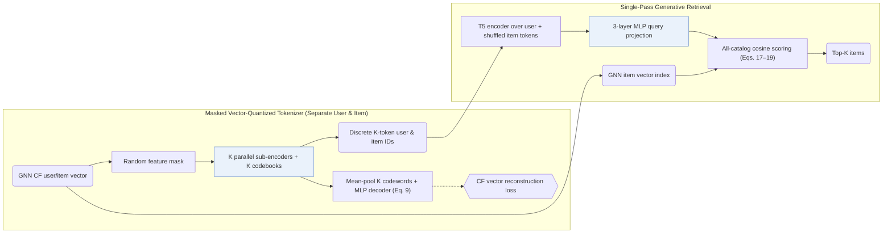

## At a Glance

Key Findings: Across LastFM, MovieLens-1M, Amazon Beauty, and Clothing, TokenRec outperforms collaborative, sequential, and LLM baselines while cutting per-user top-20 inference time to 5.76–8.43 ms against 76–102 ms for beam-search LLM baselines (Abstract, Tables 2, 3, and 5).
Limitation: Onboarding unseen users or items still requires updating the upstream GNN collaborative filtering model to produce their base embeddings, even though the MQ-Tokenizer and LLM remain frozen (Sec. II-E.2).

### 1. Why This Paper Matters

Assigning one dedicated token per user and item grows an LLM's vocabulary linearly with catalog scale (Sec. I), while text-only codes miss high-order collaborative structure and struggle on unseen users or items (Abstract). TokenRec quantizes masked GNN collaborative embeddings into compact user and item token tuples and replaces multi-step autoregressive beam search with single-pass dense vector retrieval.

### 2. How It Works

#### MQ-Tokenizer

A GNN collaborative filtering backbone pre-computes dense user and item representations stored in an item vector index (Sec. II-C.2). Separate user and item MQ-Tokenizers apply random feature masking to each GNN vector, project it through $`K`$ parallel sub-encoders, and quantize each branch against its own sub-codebook (Sec. II-C.2, Sec. II-C.3). Averaging the $`K`$ selected codewords through an MLP decoder reconstructs the unmasked GNN vector (Sec. II-C.4, Eq. 9).

> "Specifically, our MQ-Tokenizer assigns each user and item a small number of discrete tokens generated by quantizing the GNN-based representations." (Sec. II-C.1)

> "we propose to randomly mask these representations to create a challenging task that enables the tokenizer to build a comprehensive understanding and generalize well." (Sec. II-C.2)

#### Generative Retrieval

The T5 backbone encodes a prompt containing the user's discrete tokens alongside interacted item tokens—randomly shuffled during training rather than ordered chronologically (Sec. II-D.2). A 3-layer MLP projects the final hidden state into the collaborative vector space, scoring the entire catalog via cosine similarity against the stored GNN item embeddings for top-$`K`$ retrieval (Sec. II-D.3, Eqs. 17–19).

### 3. Experimental Findings

- Main comparison: under full-catalog ranking across four benchmarks, TokenRec surpasses traditional collaborative, sequential, and LLM-based recommenders on both seen and held-out users (Abstract, Tables 2–4).
- Serving latency: bypassing autoregressive token-by-token beam search cuts per-user top-20 latency by an order of magnitude (5.76–8.43 ms vs. 76–102 ms) (Sec. III-D, Table 5).

  > "This can be attributed to our generative retrieval paradigm, bypassing the most time-consuming auto-regressive decoding and beam search processes of LLMs [ 29 ] ." (Sec. III-D)

### 4. Limitations & Critical Analysis

**Our analysis.**

- TIGER quantizes item text (`Text`) via `RQ-VAE` and decodes token by token with `Beam` search; TokenRec quantizes `CF` embeddings for both users and items via `Masked VQ` and retrieves candidates in one pass via dense cosine `Scoring`.
- CID also discretizes `CF` signals via `Spectral Clus.` while retaining autoregressive `C-Beam` generation; TokenRec uses an `Encoder` query projector without emitting target tokens.
