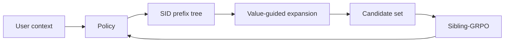

### 1. Why This Paper Matters

RL fine-tuning of generative recommenders samples candidates with likelihood-driven decoding such as beam search (Abstract). The authors name two failures of this setup. High-reward items in low-probability branches are pruned early, and candidates that share a high-probability prefix receive correlated rewards, which weakens the comparison signal for RL. A larger beam does not fix this, because it spends most extra compute on redundant high-probability candidates (Sec. 1). V-STAR changes how RL candidates are built and how their advantages are computed.

> "Our V-STAR primarily focuses on training-time improvement." (Sec. 4.4)

Based on arXiv v2.

### 2. How It Works

#### Value Head

A value head reads the policy's hidden state for each Semantic ID (SID) prefix and predicts its value (Sec. 4.1). Dense semantic returns for its training come from item embeddings computed by a frozen text encoder.

#### Value-Guided Efficient Decoding

VED treats SID decoding as building a candidate set on the prefix tree under a fixed compute budget (Sec. 4.2). A probability-guided beam initializes the tree. Each node's priority combines its predicted value with the policy entropy, and a node whose priority exceeds the average at its depth receives one new child (Eq. 11). The child is sampled from the unexpanded valid children by normalized policy probability.

> "We develop Value-Guided Efficient Decoding (VED) for budgeted candidate construction by allocating decoding compute to high-value and high-ambiguity nodes." (Sec. 1)

#### Sibling-GRPO

Sibling-GRPO groups the children of each parent prefix (Sec. 4.3). Each child's score is the mean reward of its descendant candidates, and advantages are normalized among siblings (Eq. 17).

> "We introduce Sibling-GRPO, a tree-structured objective that uses sibling groups to mitigate advantage compression under correlated candidates." (Sec. 1)

### 3. Experimental Findings

- Decoding budget: under matched training-time decoding budgets, VED outperforms beam search on the tested metrics (Sec. 5.5, Fig. 4). The budget counts model-evaluated tokens during candidate construction, not end-to-end latency.
- Training objective: combining GRPO with Sibling-GRPO gives the highest NDCG and HR among the tested objectives (Sec. 5.4, Table 4).

### 4. Limitations & Critical Analysis

**Our analysis.**

- MiniOneRec uses the same `RQ-VAE` SIDs, `Dec-Only` generator, and `NTP → RL` training; V-STAR changes only how RL candidates are sampled and how advantages are computed.
