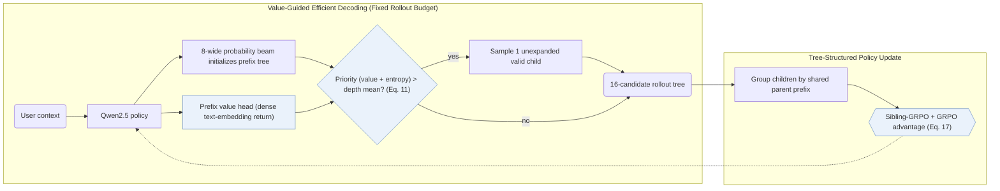
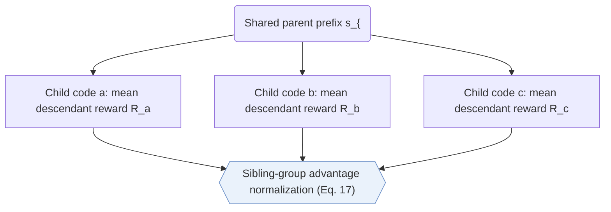

## At a Glance

Key Findings: Under matched training-time decoding budgets, V-STAR outperforms beam-search RL baselines including MiniOneRec on Amazon Industrial and Office and lifts live advertising GMV by +1.23% in a WeChat Channels online A/B test (Sec. 5.3–5.5, Tables 1 and 4, Fig. 4).
Limitation: Value-guided tree expansion applies only to training-time RL rollout construction, leaving online serving on standard likelihood beam search (Sec. 4.4).

### 1. Why This Paper Matters

Sampling RL rollouts via likelihood-driven beam search prunes high-reward items hidden behind low-probability early prefixes while packing the candidate pool with sibling trajectories that share high-probability prefixes and correlated rewards (Abstract). Simply widening the beam wastes compute on redundant head branches (Sec. 1). V-STAR reallocates rollout expansion toward high-value, high-entropy prefix nodes and normalizes policy advantages among sibling branches on the prefix tree.

> "Our V-STAR primarily focuses on training-time improvement." (Sec. 4.4)

### 2. How It Works

#### Value Head

A lightweight value head reads the policy's hidden state at each Semantic ID (SID) prefix and predicts expected return, supervised by dense semantic similarity targets computed from a frozen item text encoder (Sec. 4.1).

#### Value-Guided Efficient Decoding

Value-Guided Efficient Decoding (VED) constructs the RL rollout tree under a fixed token-evaluation budget (Sec. 4.2). Starting from an initial probability-guided beam, VED scores each tree node by combining its predicted value with policy entropy; nodes exceeding the mean priority at their depth expand one additional valid child sampled proportionally to normalized policy probability (Eq. 11).

> "We develop Value-Guided Efficient Decoding (VED) for budgeted candidate construction by allocating decoding compute to high-value and high-ambiguity nodes." (Sec. 1)

#### Sibling-GRPO

Rather than normalizing rewards flatly across correlated full sequences, Sibling-GRPO groups sibling nodes under each parent prefix, assigns each child the mean reward of its descendant leaf candidates, and normalizes advantages within each sibling group (Sec. 4.3, Eq. 17).

> "We introduce Sibling-GRPO, a tree-structured objective that uses sibling groups to mitigate advantage compression under correlated candidates." (Sec. 1)

### 3. Experimental Findings

- Budgeted rollout efficiency: across matched counts of model-evaluated tokens during RL candidate construction, VED consistently outperforms standard beam search on HR and NDCG (Sec. 5.5, Fig. 4).
- Objective ablation and live A/B test: combining sequence-level GRPO with tree-level Sibling-GRPO achieves the highest accuracy among all tested RL objectives on Industrial and Office (Sec. 5.4, Table 4) and yields +1.23% GMV in a 5-day online A/B test on WeChat Channels advertising (Sec. 5.3).

### 4. Limitations & Critical Analysis

**Our analysis.**

- MiniOneRec shares the same 3-level `RQ-VAE` SIDs, Qwen2.5 `Dec-Only` backbone, and `NTP → RL` schedule with constrained beam rollouts; V-STAR replaces uniform likelihood beam rollouts with value-and-entropy tree expansion and sibling-relative advantages.
