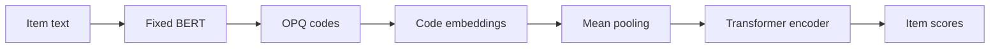

### 1. Why This Paper Matters

Transferable recommenders encode item text with a pre-trained language model (PLM) and use the encoding as the item representation (Abstract). The authors argue that this tight binding over-emphasizes text features and enlarges the effect of the domain gap (Abstract, Sec. 4). VQ-Rec inserts discrete codes between text and representation: item text maps to a vector of discrete indices, called an item code, and the code looks up the item representation in an embedding table (Sec. 2.1). VQ-Rec is a discriminative sequential recommender, not a generative one; later Semantic ID (SID) papers reuse its code scheme.

Based on arXiv v2.

### 2. How It Works

*Figure source: Fig. 1, original paper.*

#### Text to Code

A fixed BERT encoder embeds item text, and optimized product quantization (OPQ) splits the embedding into subspaces and assigns an index in each subspace independently (Sec. 2.2.1, Eq. 2). The PQ centroids are learned from the text encodings of all training domains.

#### Code to Representation

Each code position has its own code embedding table, and the item representation is the mean of the looked-up embeddings (Sec. 2.2.2, Eq. 3). The code embeddings are separate parameters from the PQ centroids.

#### Contrastive Pre-Training

A Transformer encodes the sequence of item representations (Sec. 2.3.1). The ground-truth next item is the positive. Semi-synthetic negatives replace part of an item's code at random, and mixed-domain negatives are other items in the batch (Sec. 2.3). Pre-training updates the code embeddings and the Transformer; BERT stays fixed and PQ is computed beforehand (Sec. 2.4).

#### Cross-Domain Fine-Tuning

In a new domain, VQ-Rec re-trains the PQ centroids and aligns them to the existing code embeddings with a differentiable permutation network, then fine-tunes the permuted embedding table (Sec. 2.4.1).

> "During fine-tuning, we fix the Transformer sequence encoder (transferred across different domains), and only optimize the parameters involved in item representations, enabling parameter-efficient fine-tuning." (Sec. 2.4)

A new item in a known domain needs no retraining.

> "When a new item emerges, one can encode its item text into discrete indices, and then obtain the corresponding item representations by embedding lookup." (Sec. 2.4.2)

### 3. Experimental Findings

- Main comparison: VQ-Rec is the best or second-best method on each of the six downstream datasets in the cross-domain and cross-platform settings (Table 2).
- Ablation: without fine-tuning the pre-trained model, performance drops sharply, and removing pre-training also lowers results on all tested datasets (Sec. 3.3, Table 3).
- Popularity groups: VQ-Rec performs better than SASRec in every item-popularity group (Sec. 3.4.3, Fig. 4).

  > "VQ-Rec has better performance than SASRec in all groups, especially in cold-start groups." (Sec. 3.4.3)

### 4. Limitations & Critical Analysis

**Our analysis.**

- ActionPiece starts from the same kind of `OPQ` codes but merges them into context-dependent tokens and generates them with an `Enc-Dec` generator; VQ-Rec scores items with an `Encoder` (`Scoring`).
- UTGRec also targets multi-domain transfer (`Multi-Dom`) but replaces product quantization with a `Tree` tokenizer and decodes with `Beam`.
