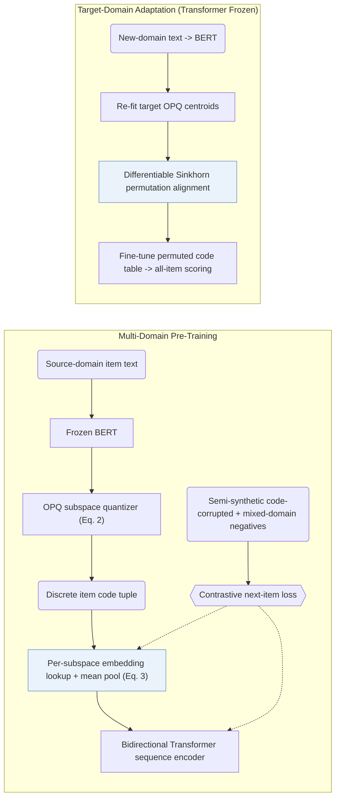

## At a Glance

Key Findings: Pre-trained across five Amazon source domains, VQ-Rec ranks first or second on all six cross-domain and cross-platform downstream datasets and outperforms SASRec in every item-popularity bucket, particularly cold-start items (Sec. 3.4.3, Table 2, Fig. 4).
Limitation: Evaluating the pre-trained encoder without downstream code-embedding fine-tuning causes a sharp drop in accuracy across target domains (Sec. 3.3, Table 3).

### 1. Why This Paper Matters

Directly feeding continuous pre-trained language model (PLM) embeddings into transferable sequential recommenders over-couples predictions to surface text style and amplifies cross-domain distribution shifts (Abstract, Sec. 4). VQ-Rec inserts discrete optimized product quantization (`OPQ`) item codes between text encodings and learnable lookup tables inside a bidirectional sequence encoder (`Scoring`), establishing the parallel subspace code representation adopted by later Semantic ID (SID) generators (Sec. 2.1).

### 2. How It Works

#### Text to Code

A frozen BERT encoder embeds item text, and optimized product quantization (OPQ) partitions the vector into orthogonal subspaces to assign one discrete centroid index per subspace independently across all source domains (Sec. 2.2.1, Eq. 2).

#### Code to Representation

Each subspace position maintains its own learnable code embedding table decoupled from the OPQ centroids, and averaging the looked-up subspace vectors forms the item representation (Sec. 2.2.2, Eq. 3).

#### Contrastive Pre-Training

A Transformer sequence encoder reads user histories of pooled code embeddings and optimizes a contrastive objective pairing the true next item against both in-batch mixed-domain negatives and semi-synthetic negatives formed by randomly perturbing subset code indices (Sec. 2.3, Sec. 2.3.1, Sec. 2.4).

#### Cross-Domain Fine-Tuning

When transferring to a downstream domain, VQ-Rec refits OPQ centroids on the target catalog, aligns new centroids to the pre-trained code embedding tables via a differentiable permutation matrix, and fine-tunes only the permuted lookup tables with the sequence Transformer frozen (Sec. 2.4, Sec. 2.4.1). Emerging items within an adapted domain require only text encoding and table lookup without retraining (Sec. 2.4.2).

> "During fine-tuning, we fix the Transformer sequence encoder (transferred across different domains), and only optimize the parameters involved in item representations, enabling parameter-efficient fine-tuning." (Sec. 2.4)

> "When a new item emerges, one can encode its item text into discrete indices, and then obtain the corresponding item representations by embedding lookup." (Sec. 2.4.2)

### 3. Experimental Findings

- Cross-domain and cross-platform transfer: across six downstream Amazon and Online Retail benchmarks, VQ-Rec achieves the best or second-best ranking accuracy against ID-based, text-based, and transferable sequential baselines (Table 2).
- Pre-training and fine-tuning ablations: skipping target-domain code-table fine-tuning degrades accuracy sharply, while removing multi-domain pre-training consistently lowers results across all six datasets (Sec. 3.3, Table 3).
- Cold-start and popularity buckets: VQ-Rec beats SASRec across every item-popularity group, with the widest gains on low-interaction cold-start items (Sec. 3.4.3, Fig. 4).

  > "VQ-Rec has better performance than SASRec in all groups, especially in cold-start groups." (Sec. 3.4.3)

### 4. Limitations & Critical Analysis

**Our analysis.**

- ActionPiece and RPG both build on unordered `OPQ` subspace codes, where ActionPiece merges co-occurring code patterns for `Enc-Dec` generation and RPG decodes long `OPQ` tuples over an item graph; VQ-Rec pools code embeddings for discriminative all-catalog `Scoring` with a frozen-transfer `Encoder`.
- UTGRec likewise targets multi-domain transfer (`Multi-Dom`) by replacing `OPQ` lookup scoring with `Tree` codebooks and autoregressive `Beam` generation.
