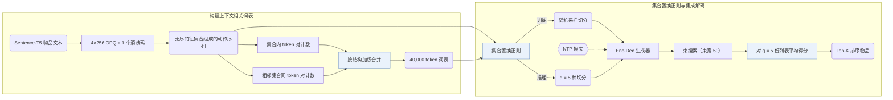

## At a Glance

Key Findings: 在 Amazon Sports and Outdoors、Beauty 和 CDs and Vinyl 上，将 OPQ 物品特征集合合并为 40,000 token 的上下文相关词表提升了 Recall@5/10 与 NDCG@5/10 并缩短归一化序列长度，而单纯缩放 TIGER 词表规模无法取得同等收益（Sec. 4.3，Sec. 4.4.1，Table 4，Table 5，Fig. 4）。
Limitation: 推理需对 q = 5 种随机集合置换切分分别执行束宽 50 的束搜索再平均得分，且论文未报告实测推理延迟及评测是否覆盖全量物品目录（Sec. 3.3.2，Sec. 3.4，Sec. 4.1）。

### 1. 为什么重要

常规生成式推荐（GR）模型孤立地将每个物品映射为固定的语义 ID（Semantic ID，SID），使同一交互动作在任何历史序列中都获得相同的固定 token（Abstract）。由于同一物品在不同交互上下文中承载的意图不同，ActionPiece 将每次动作表示为无序的 OPQ 特征码集合，并将相邻动作间的共现特征模式合并为随上下文变化的 token。

> "However, existing GR models tokenize each action independently, assigning the same fixed tokens to identical actions across all sequences without considering contextual relationships."（Abstract）

### 2. 方法

#### 行为即特征集合

ActionPiece 将 Sentence-T5 物品文本嵌入量化为 4 个无序 OPQ 码（每个码本含 256 个码字）加 1 个防冲突标识码，把每次交互表示为含 5 个特征的无序集合，用户历史随之表示为特征集合序列（Abstract，Appendix F）。

#### 构建词表

从基础特征 token 出发，ActionPiece 同时统计单个动作集合内部和相邻动作集合之间的共现 token 对，迭代合并构建含 40,000 个 token 的上下文相关词表（Abstract，Appendix G）。集合内与跨集合两类 token 对按结构差异赋予不同合并权重（Sec. 1）。

> "Considering the structural differences between token pairs, e.g., whether they occur within a single set or between two adjacent sets, we assign different weights to different pairs."（Sec. 1）

#### 集合置换正则

由于单个动作的特征集合无内在顺序，在应用合并规则前随机置换集合元素，能为同一动作序列生成多份语义等价的 token 切分（Abstract）。训练时随机采样切分增强下一 token 预测；推理时生成 $`q = 5`$ 份置换切分，以束宽 50 解码并对 5 份候选列表的物品得分取平均（Sec. 3.2.2，Sec. 3.3.2）。

### 3. 实验发现

- 主实验与词表规模：在 Sports and Outdoors、Beauty 和 CDs and Vinyl 上（5 个随机种子平均），将合并词表扩大至 40,000 token 可提升 Recall@5/10 与 NDCG@5/10 并缩短归一化序列长度（NSL），以更大的嵌入表换取更短的解码序列（Sec. 4.2，Sec. 4.4.1，Table 4，Fig. 4）。
- 词表缩放消融：仅调整 TIGER 的词表大小无法复现 ActionPiece 的提升，说明收益来自上下文相关合并而非词表容量本身（Sec. 4.3，Table 5）。

  > "These results suggest that the performance improvement of ActionPiece is not simply due to scaling the vocabulary size up or down."（Sec. 4.3）

- token 利用与案例分析：根据相邻历史为同一物品分配不同 token 提高了词表 token 使用率，兼具序列级数据增强效果，并在案例分析中捕获跨动作组合模式（Sec. 4.3，Sec. 4.4.2，Sec. 4.5）。
- 集成规模：随 $`q`$ 增大，对 $`q = 5`$ 份置换切分平均排序得分稳定优于单一切分解码（Sec. 3.3.2，Fig. 6）。

### 4. 局限与分析

**Stated by the authors.** 仅当 $`q = 5`$ 份置换切分并行推理时，整体延迟才与单切分解码相当（Sec. 3.4）。

**Our analysis.**

- 对 $`q = 5`$ 路束宽 50 的解码做集成会使计算量与显存开销随 $`q`$ 线性增加，在线服务吞吐受限时开销更为突出。
- VQ-Rec 将无序 `OPQ` 码输入双向 `Encoder` 做判别式 `Scoring`；ActionPiece 同样从无序 `OPQ` 特征集合出发，但通过跨动作合并由 `Enc-Dec` 生成器自回归生成合并 token。
