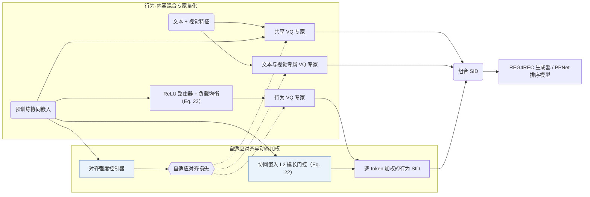

## At a Glance

Key Findings: 在含 48,106,880 个广告的工业数据集与 Amazon Beauty 上，ADC-SID 在 R@100、N@100 和 AUC 上全面优于纯内容基线（RQ-VAE、OPQ）及固定强度对齐基线（LETTER），在曝光量后 25% 的长尾物品上取得最大 AUC 增幅，并通过 5 天在线 A/B 测试验证收益（Sec. 4.2，Sec. 4.5，Sec. 5，Table 2，Table 5，Fig. 6）。
Limitation: 行为 token 权重直接由预训练协同嵌入的 L2 模长计算，效果受制于上游协同模型的标定质量，且论文未报告冲突处理策略与推理延迟（Sec. 3.4.1，Sec. 4.1.3）。

### 1. 为什么重要

语义 ID（Semantic ID，SID）通过量化物品内容特征实现跨物品知识共享，协同感知编号器则进一步将用户-物品交互信号注入离散编码（Abstract）。由于真实交互呈长尾偏斜分布，长尾物品的协同信号稀疏且含噪：统一强度的跨视图对齐会污染尾部物品的内容表征，等权重聚合又无法区分有效与含噪的行为 SID。ADC-SID 按物品自适应调节对齐强度，并为行为 token 学习动态权重。

> "unlike relatively uniform content features, user-item interactions are highly skewed, resulting in a significant quality gap in collaborative information between popular and long-tail items."（Abstract）

### 2. 方法

#### 行为-内容混合量化

ADC-SID 将量化码本拆分为学习跨模态共性信息的共享专家，以及分别建模文本、视觉与交互行为特异性的专属专家（Sec. 3.2）。

#### 自适应行为-内容对齐

对齐强度控制器不再对全部物品施加恒定拉近约束，而是根据物品热度调节行为表征与内容表征的对齐权重，防止稀疏交互噪声破坏长尾物品的内容语义（Sec. 3.3.1）。

> "To adaptively align behavior and content information for head and long-tail items, the alignment strength controller is proposed to calculate the alignment strength."（Sec. 3.3.1）

#### 动态行为加权

门控网络依据物品预训练协同嵌入的 L2 模长为每个行为 SID token 计算重要度权重，压低低置信度行为码（Sec. 3.4.1，Eq. 22）。行为分支内部配合带负载均衡损失的 ReLU 路由器，缓解行为专家间的负载失衡（Sec. 3.4.2，Eq. 23）。

> "This gate suppresses noisy behavioral SIDs, improving the robustness of behavioral SIDs when incorporated with downstream recommendations."（Sec. 3.4.1）

### 3. 实验发现

- 生成式检索与排序主实验：在东南亚电商广告数据集（35,154,135 用户、48,106,880 广告）和 Amazon Beauty（22,363 用户、12,101 物品）上，融合行为与内容的 SID（RQ-Kmeans、LETTER）在生成式检索（基于 REG4REC 的 R@50、R@100、N@50、N@100）和判别式排序（基于 PPNet 的 AUC）上均优于纯内容 SID（RQ-VAE、OPQ），ADC-SID 在两类任务中整体最优（Abstract，Sec. 4.1，Sec. 4.2，Table 1，Table 2）。
- 组件消融：工业数据集消融验证了共享-专属 MoE-VQ 结构、自适应对齐控制器，以及相对等权重方案的动态行为加权收益（Sec. 4.3.2，Table 3）。
- 热度分层表现：按最近 30 天曝光量将物品划分为热门组（前 25%）和长尾组（后 25%），ADC-SID 在长尾组取得最大的 AUC 提升，同时保持热门组精度（Sec. 4.5，Fig. 6）。
- 在线 A/B 测试：采用 8 位 SID 在 10% 随机广告流量上开展 5 天在线 A/B 实验，验证了线上业务指标收益（Sec. 5，Table 5）。

### 4. 局限与分析

**Our analysis.**

- 行为门控直接依赖上游协同嵌入的 L2 范数，若预训练协同模型的嵌入模长未良好校准，将影响行为 token 的权重分配（Sec. 3.4.1）。
- 论文未说明 SID 冲突消解规则，且 Sec. 4.1.3 中工业数据集的码本大小存在排版笔误。
- MME-SID 同样融合文本、视觉与协同三路特征，但采用 `MM-RQ` 编号器配 `Dec-Only` 模型做判别式 `Scoring`；ADC-SID 则用 `MoE-VQ` 混合专家编号器连接 `Enc-Dec` 生成器（`REG4REC`）与 `PPNet`。
