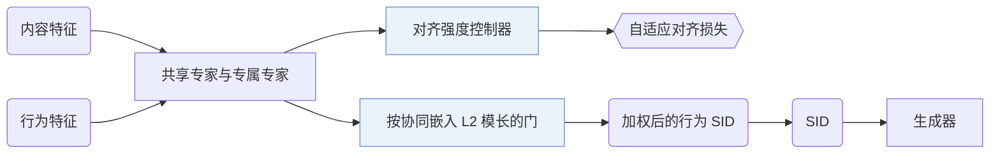

## At a Glance

Limitation: 行为权重由预训练协同嵌入的模长算出，因此取决于这个嵌入的质量（Sec. 3.4.1）。

### 1. 为什么重要

语义 ID（Semantic ID，SID）把物品内容特征量化，让物品之间能共享知识；已有方法再往 SID 里加入协同信息（Abstract）。用户和物品的交互高度偏斜，长尾物品的协同信息弱得多（Abstract）。作者指出两个后果：不加区分的对齐让这些噪声污染尾部物品的内容表示；等权重又看不出哪些行为 SID 有用（Abstract）。

> "unlike relatively uniform content features, user-item interactions are highly skewed, resulting in a significant quality gap in collaborative information between popular and long-tail items."（Abstract）（交互高度偏斜，热门和长尾物品的协同信息质量差距很大。）

### 2. 方法

#### 行为-内容混合量化

共享专家学习行为和内容共有的信息，专属专家学习各自模态的信息（Sec. 3.2）。

#### 自适应行为-内容对齐

对齐强度控制器决定热门物品和长尾物品的行为与内容对齐得多紧（Sec. 3.3.1）。

> "To adaptively align behavior and content information for head and long-tail items, the alignment strength controller is proposed to calculate the alignment strength."（Sec. 3.3.1）（控制器为热门和长尾物品分别计算对齐强度。）

#### 动态行为加权

一个门根据预训练协同嵌入的 L2 模长，为每个行为 SID 学一个重要度分数（Sec. 3.4.1，Eq. 22）。带负载均衡的 ReLU 路由器减轻行为专家之间的训练不均（Sec. 3.4.2，Eq. 23）。

> "This gate suppresses noisy behavioral SIDs, improving the robustness of behavioral SIDs when incorporated with downstream recommendations."（Sec. 3.4.1）（这个门压低有噪声的行为 SID。）

### 3. 实验发现

- 基线类别：RQ-Kmeans、LETTER 这类行为-内容对齐的 SID，在 R@100、N@100 和 AUC 上都好于 RQ-VAE、OPQ 这类只用内容的 SID（Sec. 4.2，Table 2）。
- 任务：SID 在生成式和判别式两类任务上都做了评估（Abstract）。
- 行为加权：消融把学到的权重和等权重做了对比（Sec. 4.3.2）。
- 热度分组：按最近 30 天的曝光把物品分成热门组（前 25%）和长尾组（后 25%），ADC-SID 在尾部物品上提升最多（Sec. 4.5，Fig. 6）。

### 4. 局限与分析

**Our analysis.**

- MME-SID 用同样三种输入，配 `MM-RQ` 码和 `Dec-Only` 生成器，用 `Scoring` 打分；ADC-SID 用 `MoE-VQ` 码和 `Enc-Dec` 生成器。
