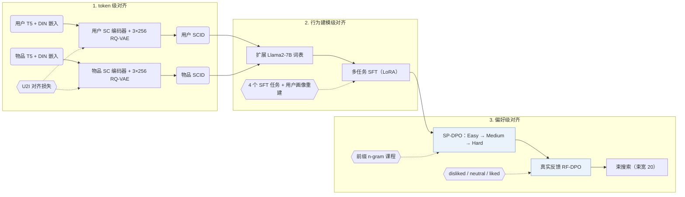

## At a Glance

Key Findings: 在公开基准数据集上，Align3GR 相比最强基线的 Recall@10 最高提升 +17.8%、NDCG@10 最高提升 +20.2%，并在工业广告平台的离线 Recall@100 与线上收入指标上取得提升（Abstract，Table 1，Table 2）。
Limitation: Align3GR 需在 Llama2-7B 上依次完成用户/物品双路 3 层 RQ-VAE 编号、四任务 SFT、3 阶段 SP-DPO 和 RF-DPO 训练，且论文未报告冲突消解规则与推理延迟（Experimental Settings）。

### 1. 为什么重要

将预训练大语言模型（LLM）迁移至生成式推荐时，自然语言 token 空间与协同行为模式之间存在语义和行为双重错位（Abstract）。LC-Rec 等早期 LLM 推荐器主要通过监督微调任务对齐物品语义 ID（Semantic ID，SID）。Align3GR 将对齐扩展至三个统一层级：用户与物品双路语义-协同编号、双向多任务 SFT，以及自博弈课程结合真实反馈的渐进式 DPO。

> "To bridge this gap, we propose Align3GR, a novel framework that unifies token-level, behavior modeling-level, and preference-level alignment."（Abstract）

### 2. 方法

#### token 级对齐

双路语义-协同（SC）编码器分别为用户和物品融合 T5 文本嵌入与 DIN 行为嵌入，并由两个独立的 3 层 RQ-VAE（每层码本含 256 个 32 维码字）量化为用户 SCID 与物品 SCID（Fig. 2 caption，Experimental Settings）。将两类离散 SCID token 直接扩充进 Llama2-7B 词表，可避免自回归生成时的词表外切分。

> "Following previous work (Zheng et al. 2024), we first expand the LLM vocabulary to include the SCID tokens of the user and the item, thus avoiding out-of-vocabulary issues and ensuring smooth integration with autoregressive generation tasks."（Behavior Modeling-level Alignment）

#### 行为建模级对齐

监督微调（SFT）沿用并扩展 LC-Rec 的四个子任务：序列物品预测、非对称物品预测、基于意图的物品预测，以及个性化偏好推断（Multi-task SFT）。每个任务的提示词均嵌入用户 SCID token，除预测目标物品 SCID 外，还要求从用户 SCID 逆向重建用户画像文本，实现双向对齐（Multi-task SFT）。

#### 偏好级对齐

自博弈 DPO（SP-DPO）依据 3 层层级 SCID 的前缀 n-gram 匹配度，按 Easy、Medium、Hard 三个由易到难的课程阶段构造负样本（Preference-level Alignment）。随后的真实反馈 DPO（RF-DPO）利用日志中划分为 disliked、neutral 和 liked 三档的真实反馈继续微调策略（Preference-level Alignment）。

> "Specifically, considering the hierarchical nature of SCID, we divide progressive SP-DPO learning into three stages: Easy, Medium, and Hard, using a prefix-ngram match metric (Zheng et al. 2025)"（Preference-level Alignment）

### 3. 实验发现

- 公开基准对比：在 5-core 过滤后的 Amazon Instruments、Amazon Beauty 和 Yelp 上（5 个随机种子平均，束宽 20），Align3GR 优于传统序列推荐、生成式模型（TIGER、LETTER）与 LLM 基线（LC-Rec、EAGER-LLM），相比最强基线的 Recall@10 最高提升 +17.8%、NDCG@10 最高提升 +20.2%（Abstract，Experimental Settings，Table 1）。
- 多层级消融：消融实验分别验证了双路用户-物品 SCID 编号（Table 3）、双向 SFT 任务（Table 4），以及 3 阶段 SP-DPO 叠加 RF-DPO 的逐步增益（Table 5，Fig. 4）。
- 工业部署：在大规模广告推荐平台上，Align3GR 在离线 Recall@100 上超过双塔基线与 TIGER，并在 10% 流量（超 40 million 用户）的多周在线 A/B 测试中带来广告收入提升，随后全量上线（Abstract，Table 2）。

### 4. 局限与分析

**Our analysis.**

- 训练流程依次串联双路 SCID 编号器、四任务 SFT、3 阶段 SP-DPO 与 RF-DPO，物品目录或用户分布更新时需重跑多阶段训练。
- 用户 SCID 依赖历史交互离线量化，无历史交互的冷启动用户缺少预置的用户 SCID token。
- EAGER-LLM 同样将语义和协同信号输入 `Dec-Only` LLM，但仅对物品做 `Dual H-KM` 编码；Align3GR 对用户与物品双侧执行 `Dual RQ`（`RQ-VAE`）编号，并引入两阶段 DPO（`NTP → DPO`）。
