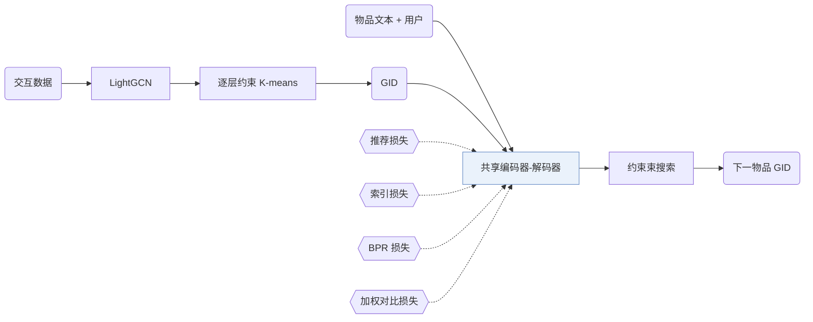

## At a Glance

Limitation: 生成式标识（GID）来自离线的 LightGCN 嵌入和聚类，没有交互的物品就没有可聚类的协同表示（Sec. 4.2）。

### 1. 为什么重要

现有基于 LLM 的方法会融合内容和协同信号，但依赖文本生成；作者认为这和推荐任务并不完全对得上（Abstract）。ColaRec 改用为推荐定制的序列到序列模型，直接解码物品标识（Abstract）。

> "To model collaborative signals, the GIDs are constructed from a pretrained collaborative filtering model, and the user is represented as the content aggregation of interacted items."（Abstract）（GID 由预训练协同过滤模型构建，用户用交互过的物品内容聚合表示。）

### 2. 方法

#### 构建生成式标识

ColaRec 对预训练 LightGCN 得到的物品表示逐层做约束 K-means（Sec. 4.2）。

> "Specifically, we first extract item representations from a pretrained LightGCN model. Then the constrained K-means algorithm is called hierarchically based on the item representations."（Sec. 4.2）（先取 LightGCN 物品表示，再逐层做约束 K-means。）

#### 物品索引任务

索引任务把物品的文本和与它交互过的用户映射到它的 GID（Sec. 4.4，Eq. 7）。它和推荐任务共用同一个编码器-解码器（Sec. 4.4）。

#### 训练目标

推荐损失、索引损失、带一个采样负例的 BPR 损失和加权对比损失一起训练（Sec. 4.5，Eq. 11）。

> "The idea is that items with similar GIDs should also be similar in the content-based semantic space."（Sec. 4.5）（GID 相近的物品，内容语义也应相近。）

#### 推理

约束束搜索只允许当前前缀下合法的 token（Sec. 4.5）。

### 3. 实验发现

- 主实验：ColaRec 在四个基准数据集上好于各基线（Abstract，Table 2）。
- 消融：Table 4 分别去掉文本内容、索引任务、BPR 损失或对比损失，并把 GID 换成另外三种标识（Table 4）。

### 4. 局限与分析

**Our analysis.**

- 对比损失把内容表示拉向 GID 的结构。由此推断，内容相似度会被协同聚类重新塑形，聚类有噪声的物品可能受损。
- SEATER 也从 `CF` 输入构建树状标识（`Tree-Clus.`）；ColaRec 在输入里加了物品内容（`Text+CF`）。
