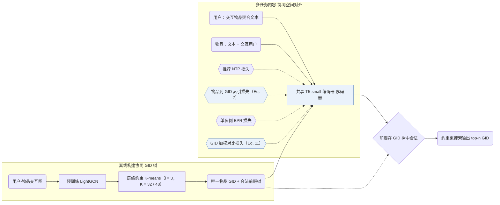

## At a Glance

Key Findings: 在 Amazon Beauty、Sports and Outdoors、Cell Phones and Accessories 与 Food.com Recipe 的全量目录评测中，ColaRec 在 Recall@5/10 与 NDCG@5/10 上优于协同过滤、内容增强与生成式基线（含 TIGER 和 LC-Rec），消融实验证实了物品到 GID 索引任务及对比对齐的有效性（Sec. 5.2，Table 2，Table 3，Table 4）。
Limitation: 生成式标识（GID）由预训练 LightGCN 嵌入经离线层级约束 K-means 聚类构建，无交互记录的冷启动物品缺少可用于聚类的协同表征（Sec. 4.2）。

### 1. 为什么重要

基于提示词的 LLM 推荐方法通过自然语言文本生成来融合内容与协同信号，开放式文本解码与全量物品目录排序目标并不一致（Abstract）。ColaRec 从预训练协同过滤图模型中为每个物品构建树状语义 ID（Semantic ID，SID）——论文称为生成式标识（GID）——并用 T5-small 编码器-解码器从用户交互物品的聚合文本中解码目标 GID，同时对齐内容空间与协同空间。

> "To model collaborative signals, the GIDs are constructed from a pretrained collaborative filtering model, and the user is represented as the content aggregation of interacted items."（Abstract）

### 2. 方法

#### 构建生成式标识

ColaRec 从预训练 LightGCN 模型提取物品嵌入，递归调用容量受限的 K-means 算法（层数 $`l = 3`$，Amazon 每层簇数 $`K = 32`$，Recipe 为 $`K = 48`$），限制第 $`t`$ 层每个簇最多包含 $`K^{l-t}`$ 个物品，保证每个叶节点唯一对应一个物品（Sec. 4.2，Sec. 5.4）。

> "Specifically, we first extract item representations from a pretrained LightGCN model. Then the constrained K-means algorithm is called hierarchically based on the item representations."（Sec. 4.2）

#### 物品索引任务

为弥合文本输入与协同 GID 之间的鸿沟，辅助物品索引任务将物品自身文本及交互过的用户集合输入共享的 T5-small 编码器-解码器，直接预测该物品对应的 GID（Sec. 4.4，Eq. 7）。

#### 训练目标

ColaRec 联合优化用户到 GID 的推荐生成损失、物品到 GID 的索引损失、带 1 个采样负例的 BPR 排序损失，以及按 GID 前缀重合度加权的对比损失（Sec. 4.5，Eq. 11）。

> "The idea is that items with similar GIDs should also be similar in the content-based semantic space."（Sec. 4.5）

#### 推理

推理阶段采用约束束搜索，每步屏蔽不在 GID 前缀树中的非法后继 token，确保生成的每条 GID 均对应目录中的真实物品（Sec. 4.5）。

### 3. 实验发现

- 全量目录对比：按每用户 8:1:1 随机切分（3 次运行取平均），在 Beauty（22,363 用户 / 12,101 物品）、Sports and Outdoors（35,598 / 18,357）、Cell Phones and Accessories（27,879 / 10,429）和 Food.com Recipe（17,813 / 41,240）四个数据集上，ColaRec 在 Recall@5/10 和 NDCG@5/10 上均优于协同过滤、内容协同与生成式基线（Abstract，Table 1，Table 2）。
- 长尾用户分析：按交互频次对用户分桶的实验显示，ColaRec 在稀疏历史用户上同样保持优势（Table 3）。
- 多任务与标识消融：移除物品文本、索引任务、BPR 损失或加权对比损失均导致指标下降，且基于 LightGCN 的协同 GID 优于随机 ID、纯文本 K-means ID 与扁平 ID（Table 4，Fig. 4，Fig. 5）。

### 4. 局限与分析

**Our analysis.**

- 加权对比损失强行将内容表征拉向协同 GID 树结构，据此推断，低频物品若因交互稀疏而被分入含噪协同簇，其内容语义相似度也会受到扭曲。
- 论文未报告约束束搜索的具体束宽数值及推理延迟（Sec. 4.5，Sec. 5）。
- SEATER 同样基于纯协同信号（`CF`）构建均衡树状标识（`Tree-Clus.`）；ColaRec 则同时引入物品文本与协同结构（`Text+CF`），并通过物品索引任务与对比损失对齐两侧空间。
