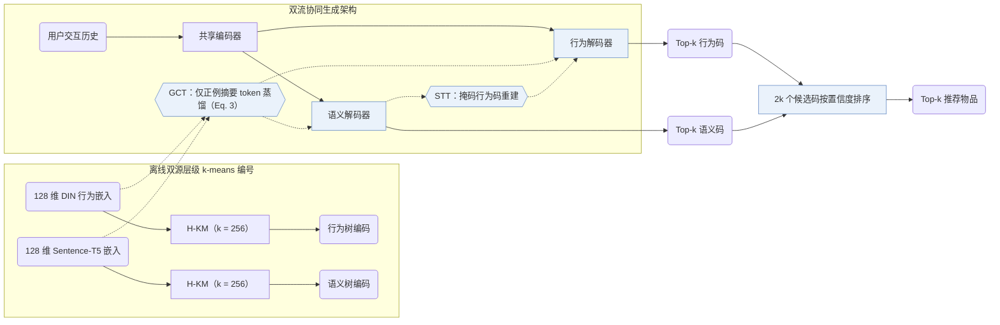

## At a Glance

Key Findings: 在 Amazon Beauty、Sports and Outdoors、Toys and Games 与 Yelp 上，EAGER 全面优于序列推荐、树结构与单流生成式基线（Table 2）；消融实验中移除双流架构带来最大性能下降（Sec. 4.3，Table 3）；在 Beauty 上单样本推理耗时为 0.0325 s，而 TIGER 为 0.0281 s（Table 6）。
Limitation: 推理时需在两个独立解码器中分别执行束搜索（束宽 100）并按对数概率置信度合并 2k 个候选，使 Beauty 上的单样本耗时从 TIGER 的 0.0281 s 增至 0.0325 s（Sec. 3.6，Table 6）。

### 1. 为什么重要

单流生成式推荐模型仅从交互行为或内容语义单一视图构建物品的语义 ID（Semantic ID，SID），要么丢失另一视图的互补信号，要么将两类异构特征强行压缩进同一量化空间（Abstract）。EAGER 从三方面协同建模两类信息：统一的双流编码器-解码器架构、行为与语义各自独立的层级编码树，以及跨流蒸馏与迁移任务。

> "we propose (1) a two-stream generation architecture leveraging a shared encoder and two separate decoders to decode behavior tokens and semantic tokens with a confidence-based ranking strategy"（Abstract）

### 2. 方法

#### 行为码与语义码

EAGER 分别用预训练 DIN 提取 128 维行为嵌入，用 Sentence-T5 提取 128 维文本语义嵌入（Sec. 4.1）。两路嵌入各自通过分支数 $`k = 256`$ 的层级 k-means（`Dual H-KM`）递归聚类，直至每个叶节点仅含单个物品，为每个物品生成独立的行为码与语义码（Sec. 3.3，Sec. 4.1）。

#### 全局对比任务

在全局对比任务（GCT）中，两个解码器各自在序列末尾附加摘要 token，并采用无需负采样的纯正例余弦距离度量（替代 InfoNCE），将摘要隐状态向该流冻结的预训练物品嵌入（DIN 或 Sentence-T5）蒸馏对齐（Sec. 3.4，Eq. 3）。

#### 语义引导迁移任务

语义引导迁移任务（STT）利用语义流的全局特征去重建被随机掩码的行为码 token，并配合二分类相关性判别器，在不混淆两套码本的前提下将语义先验迁移至行为解码流（Sec. 3.5）。

#### 置信度排序

推理阶段，行为解码器与语义解码器分别束搜索返回 $`k`$ 条候选编码，再按序列对数概率计算的置信度对合并后的 $`2k`$ 个预测统一排序（Sec. 3.6）。

> "With the 2*k prediction codes, we calculate the log probabilities over the codes as the confidence score of each prediction, which is similar to the perplexity used in the language model and the lower value indicates more confidence."（Sec. 3.6）

### 3. 实验发现

- 主实验对比：在 5-core 过滤的 Beauty（22,363 用户 / 12,101 物品）、Sports and Outdoors（35,598 / 18,357）、Toys and Games（19,412 / 11,924）与 Yelp（30,431 / 20,033）四个基准上，EAGER 在 Recall@5/10/20 与 NDCG@5/10/20 上全面优于序列推荐、树模型与生成式基线（Abstract，Table 1，Table 2）。
- 关键模块消融：移除双流生成架构（TSG）造成的指标滑坡最大，移除全局对比任务（GCT）的损失大于移除语义引导迁移任务（STT）（Sec. 4.3，Table 3）。

  > "Removing GCT leads to more performance drops than removing STT, suggesting that global information distillation of the inter-code is slightly more important than the knowledge flow between the intra-code."（Sec. 4.3）

- 视觉模态扩展：在 Yelp 上使用 ViT-B 提取物品封面视觉特征构建视觉语义编码流，同样优于单流基线（Sec. 4.4，Table 4）。
- 推理速度对比：在 Beauty 上取 top-$`k = 5`$、束宽 100 时，EAGER 单样本耗时 0.0325 s，对应 TIGER 为 0.0281 s、RecForest 为 0.0499 s、DIN 全库打分为 0.2349 s（Table 6）。

### 4. 局限与分析

**Our analysis.**

- 行为树和语义树均依赖冻结的上游编码器与精确到单物品叶节点的离线层级 k-means，物品库更新时需重跑双路编码与聚类树。
- 直接按序列对数概率合并两个解码器的 top-$`k`$ 候选列表，隐含假设行为解码器与语义解码器的输出概率尺度一致（Sec. 3.6）。
- CoST 在编号器内部引入对比学习目标（`C-RQ`）；EAGER 则保持 `Dual H-KM` 离散码固定，在 `Dual Enc-Dec` 生成器侧施加全局对比蒸馏（`GCT`）与跨流掩码重建（`STT`）。
