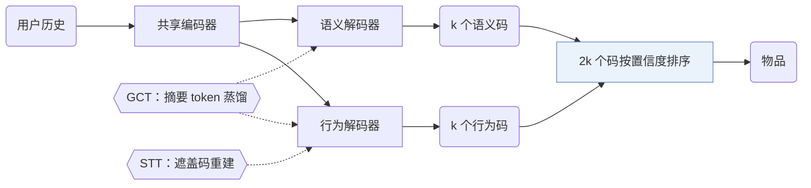

## At a Glance

Key Findings: 消融中去掉双流结构下降最多（Sec. 4.3，Table 3）；在 Beauty 上，EAGER 推理每个样本耗时 0.0325 s，TIGER 为 0.0281 s（Table 6）。
Limitation: 推理要在两个解码器里分别做束搜索再合并结果，所以 EAGER 比 TIGER 慢（Sec. 3.6，Table 6）。

### 1. 为什么重要

现有生成式方法只用物品信息的行为面或语义面，作者认为这忽略了两者的互补（Abstract）。EAGER 为结合两者提出三点要求：一个结构同时处理两类特征，两类特征各自独立学习，两者之间有交互（Abstract）。

> "we propose (1) a two-stream generation architecture leveraging a shared encoder and two separate decoders to decode behavior tokens and semantic tokens with a confidence-based ranking strategy"（Abstract）（共享编码器加两个解码器，分别解码行为 token 和语义 token，再按置信度排序。）

### 2. 方法

#### 行为码与语义码

行为编码器是预训练的 DIN，语义编码器是 Sentence-T5，隐藏维度为 128（Sec. 4.1）。层级 k-means（簇数 256）把每个嵌入变成码（Sec. 3.3，Sec. 4.1）。

#### 全局对比任务

每一路的摘要 token 向该路的预训练物品嵌入蒸馏，用只含正例的对比度量，不用 InfoNCE（Sec. 3.4，Eq. 3）。

#### 语义引导迁移任务

语义全局特征用来重建被遮盖的行为码，再加一个识别目标训练相关性分类器（Sec. 3.5）。

#### 置信度排序

每个解码器返回 $`k`$ 个码，$`2k`$ 个预测按对数概率排序（Sec. 3.6）。

> "With the 2*k prediction codes, we calculate the log probabilities over the codes as the confidence score of each prediction, which is similar to the perplexity used in the language model and the lower value indicates more confidence."（Sec. 3.6）（用 2k 个预测码的对数概率作置信度，类似困惑度，越低越可信。）

### 3. 实验发现

- 主实验：EAGER 在四个公开基准上好于已有方法（Abstract）。
- 消融：去掉全局对比任务（GCT）比去掉语义引导迁移任务（STT）下降更多（Sec. 4.3，Table 3）。

  > "Removing GCT leads to more performance drops than removing STT, suggesting that global information distillation of the inter-code is slightly more important than the knowledge flow between the intra-code."（Sec. 4.3）（GCT 比 STT 稍重要。）

- 视觉特征：在 Yelp 上，用 ViT-B 提取物品封面特征，得到一组视觉语义码（Sec. 4.4，Table 4）。
- 推理速度：在 Beauty 上取 top-k 5、束宽 100，RecForest 每个样本 0.0499 s，DIN 0.2349 s（Table 6）。

### 4. 局限与分析

**Our analysis.**

- 两套码都来自冻结的编码器和离线聚类。由此推断，加入新物品要重跑两个编码器和聚类。
- CoST 用对比目标训练码（`C-RQ`）；EAGER 的 `Dual H-KM` 码固定不变，对比项加在生成器一侧。
