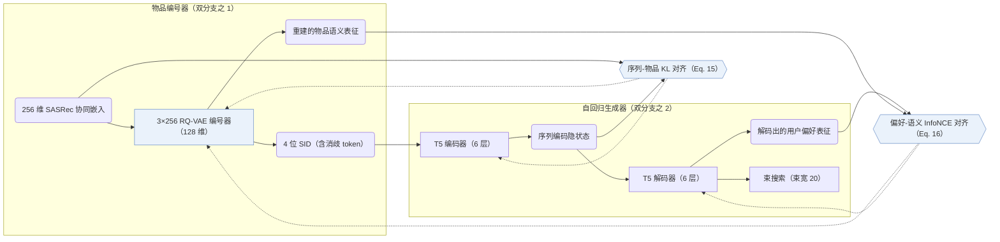
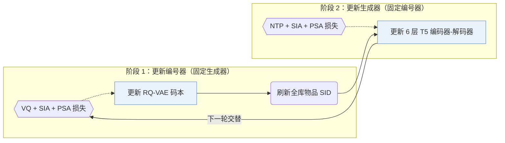

## At a Glance

Key Findings: 在 Amazon Musical Instruments、Industrial and Scientific 与 Video Games 的全量目录评测中，ETEGRec 在 Recall@5/10 和 NDCG@5/10 上优于序列推荐及固定编号器生成式基线（含 TIGER、LETTER 和 CID），并在留出的未见新用户（交互最少的 5% 用户）上保持领先（Sec. 4.2，Sec. 4.4.1，Table 3，Table 4，Fig. 2）。
Limitation: RQ-VAE 编号器仅读取协同物品嵌入，无历史交互的新物品无法获得离散编码，且论文未报告实测推理延迟（Sec. 3.2.1，Sec. 3.5）。

### 1. 为什么重要

两阶段生成式推荐模型先离线训练语义 ID（Semantic ID，SID）编号器并冻结物品编码，再独立训练序列生成器，导致离散编号空间与自回归推荐目标脱节（Abstract）。ETEGRec 在双编码器-解码器框架内统一物品编号器与序列生成器，通过两项对齐损失与交替优化实现协同训练。

> "To enable synergistic interaction between these components, we propose a recommendation-oriented alignment strategy, which includes two key optimization objectives: sequence-item alignment and preference-semantic alignment."（Abstract）

### 2. 方法

#### 物品编号器

物品编号器读取每个物品的 256 维协同嵌入（如由 SASRec 提取），经 3 层 RQ-VAE（每层含 256 个 128 维码字）逐层残差量化，并在末尾附加 1 个唯一性消歧 token，组成 4 位 SID（Sec. 3.2.1，Sec. 4.1.4）。

> "By taking a hierarchical scheme, we essentially organize the items in a tree-structured way, which is particularly suitable for generative tasks."（Sec. 3.2.1）

#### 面向推荐的对齐

序列-物品对齐最小化生成器编码器序列隐状态与目标物品协同嵌入经量化后的 token 分布散度（Sec. 1，Eq. 15）。偏好-语义对齐则在生成器解码器输出的用户偏好表征与 RQ-VAE 解码器重建的目标物品语义表征之间施加对比学习约束（Sec. 1，Eq. 16）。

#### 交替优化

直接联合反传梯度会在生成器尚未收敛时频繁改变物品离散编码；ETEGRec 改用交替优化策略：在编号器阶段固定生成器，用量化损失与两项对齐损失更新 RQ-VAE；在生成器阶段固定 SID，用下一 token 预测损失与对齐损失更新 T5 生成器（Sec. 3.4）。

> "In order to improve the training stability, we propose an alternating optimization strategy to mutually train the item tokenizer and the generative recommender."（Sec. 3.4）

### 3. 实验发现

- 全量目录对比：在 5-core 过滤的 Amazon 2023 Musical Instruments（57,439 用户 / 24,587 物品）、Industrial and Scientific（50,985 / 25,848）与 Video Games（94,762 / 25,612）上（束宽 20），ETEGRec 在 Recall@5/10 与 NDCG@5/10 上显著优于序列推荐与生成式基线（配对 t 检验）（Abstract，Sec. 4.1，Table 2，Table 3）。
- 对齐与优化消融：移除序列-物品对齐、偏好-语义对齐或交替更新策略均会降低推荐精度，证实端到端编号器反馈优于固定编号方案（Table 4，Fig. 4）。
- 未见新用户泛化：在 Musical Instruments 和 Industrial and Scientific 上将交互最少的 5% 用户从编号器与生成器训练集中同时留出作为未见用户，ETEGRec 在已见与未见两组用户上均优于 LETTER 和 TIGER（Sec. 4.4.1，Fig. 2）。

### 4. 局限与分析

**Our analysis.**

- 交替训练阶段之间刷新编号器会在训练中途改变物品 SID，需要周期性重算全库物品编码以维持生成器输入一致（Sec. 3.4）。
- Sec. 3.5 仅给出渐近复杂度分析，未报告实际端到端训练耗时开销或在线推理延迟。
- LETTER 同样利用协同信号正则化 `Learn. RQ` 编码，但在生成器训练前即冻结编号器（`Fixed`）；ETEGRec 则交替更新 `Learn. RQ` 编号器与 `Enc-Dec` 生成器（`Altern.`）。
