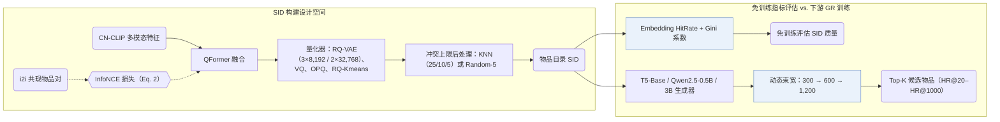

## At a Glance

Key Findings: 在淘宝在线 A/B 测试中，依据 FORGE 基准结论选出的语义 ID（Semantic ID，SID）构建策略使成交笔数提升 0.35%；离线实验表明免训练指标 Embedding HitRate 与 Gini 系数在 250 million 物品的 AL-GR 数据集上与下游 HR@20–HR@1000 强相关（Abstract，Sec. 3.4，Sec. 4.2，Table 3，Fig. 3）。
Limitation: 动态束搜索在最后一步扩展至 1,200 个候选 SID 且未报告实测推理延迟，免训练 SID 质量指标也仅在本基准的数据集内验证了相关性（Sec. 3.2，Sec. 3.4）。

### 1. 为什么重要

工业级生成式检索（GR）系统在构建语义 ID（SID）时面临特征模态、向量量化器与冲突消解等大量设计选择，而传统做法每次评估编号方案都需高成本训练完整的 GR 生成器（Abstract）。FORGE 在开源的亿级淘宝数据集 AL-GR 上系统评测这些构建策略，并提出无需训练生成器即可预判 SID 质量的评估指标。

> "Specifically, FORGE provides a taxonomy of the SID construction process from several perspectives and validates their impact on downstream GR through offline experiments across diverse settings."（Abstract）

### 2. 方法

#### 物品表示

FORGE 用 CN-CLIP 编码物品图文内容并经 QFormer 融合（Sec. 3.1.1）。量化前以物品共现表（`i2i`）中的正例对构造 InfoNCE 对比损失，将用户协同行为模式注入多模态融合表征（Sec. 3.1.1，Eq. 2）。

#### SID 编码与冲突后处理

在 3 层 × 8,192 码字和 2 层 × 32,768 码字等配置下，基准对比了 RQ-VAE 与随机分配、多码本 VQ、OPQ 及 RQ-Kmeans（Sec. 3.1.2，Sec. 4.1，Table 9，Table 11）。为限制单个 SID 挂载的物品数量，进一步采用基于 KNN 的重分配（冲突阈值设为 25、10 或 5）或末位码字 Random-5 随机分配做冲突后处理（Sec. 3.1.3）。

#### 动态束搜索

自回归解码阶段采用逐层扩束的动态束搜索：第 1 步束宽为 300，第 2 步为 600，最后一步（第 3 步）扩展至 1,200，再将候选 SID 映射回物品集合（Sec. 3.2，Sec. 3.4）。

#### SID 质量指标

为免除下游 GR 训练开销，Embedding HitRate 评估量化空间对近邻关系的保持度，Gini 系数衡量物品在 SID 空间中的分布均衡度（Sec. 3.4）。

> "The Gini coefficient measures the deviation between a uniform SID distribution and the actual item distribution, where a lower value indicates a more balanced assignment."（Sec. 3.4）

### 3. 实验发现

- 免训练指标与 HR 强相关：在 AL-GR（S1–S3 三个时间阶段）与 Amazon Clothing 的多组配置上，Embedding HitRate 和 Gini 系数均与下游生成式检索的命中率（HR@20 至 HR@1000）呈强相关（Sec. 3.4，Sec. 4.2，Table 3，Table 4，Fig. 3，Fig. 4）。

  > "Our experiments show that both metrics are strongly correlated with HR, thus enabling efficient SID evaluation without additional GR training."（Sec. 3.4）

- 模态、量化器与骨干对比：引入 `i2i` 协同对比对齐（Table 5）、采用 RQ-VAE 替代 RQ-Kmeans（Table 9）、加入冲突后处理（Table 3），以及将生成骨干从 T5-Base（0.2B）扩展至 Qwen2.5-0.5B 和 Qwen2.5-3B（Table 12）均带来稳定的检索 HR 提升。
- 工业数据集开源与全量部署：论文开源包含 14 billion 次交互、250 million 个多模态物品的淘宝数据集 AL-GR（Table 1 具体统计为 131M 用户 / 251M 物品）；基于基准结论选定的 SID 策略已在淘宝全量部署，在线 A/B 测试成交笔数提升 0.35%（Abstract，Sec. 3.3）。

### 4. 局限与分析

**Our analysis.**

- Embedding HitRate 与 Gini 系数同下游 HR 的强相关性建立在冻结编号器与后处理变体之上；若编号器与生成器端到端联合训练，这一相关性需重新检验。
- 最后一步束宽放大至 1,200 个候选 SID 显著增加了束搜索与物品查表开销，而论文未报告在线推理延迟。
- OneRec 采用 `R-KM` 编码，OneRec-V2 采用 `R-KM†` 编码；FORGE 在 Table 9 中将 `RQ-Kmeans` 与 `RQ-VAE` 直接对比，并选定带冲突后处理的 `RQ-VAE` 作为主力配置。
