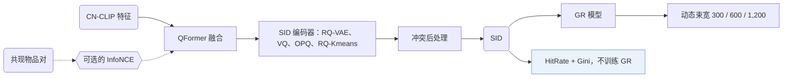

## At a Glance

Key Findings: 在淘宝的在线 A/B 测试中，按基准结论选出的语义 ID（Semantic ID，SID）构建策略让成交笔数提升 0.35%（Abstract）。

### 1. 为什么重要

现有研究很少考察 SID 该怎样构建，评估 SID 通常还要花大成本训练生成式检索（GR）模型（Abstract）。FORGE 把这些选择做成一个基准。

> "Specifically, FORGE provides a taxonomy of the SID construction process from several perspectives and validates their impact on downstream GR through offline experiments across diverse settings."（Abstract）（FORGE 给 SID 构建过程分类，并用离线实验检验各选择对 GR 的影响。）

### 2. 方法

#### 物品表示

物品用 CN-CLIP 编码，再用 QFormer 融合（Sec. 3.1.1）。可选的 InfoNCE 损失以物品共现表中的物品对为正例，引入用户行为模式（Sec. 3.1.1，Eq. 2）。

#### SID 编码与冲突后处理

基准比较了 RQ-VAE 与随机分配、多重 VQ、OPQ、RQ-Kmeans（Sec. 3.1.2）。基于 KNN 和基于随机的后处理限制每个 SID 下的物品数（Sec. 3.1.3）。

#### 动态束搜索

束宽第一步为 300，第二步为 600，最后一步为 1,200（Sec. 3.2）。

#### SID 质量指标

Embedding HitRate 和 Gini 系数不需要训练 GR 就能衡量 SID 质量（Sec. 3.4）。

> "The Gini coefficient measures the deviation between a uniform SID distribution and the actual item distribution, where a lower value indicates a more balanced assignment."（Sec. 3.4）（Gini 系数衡量实际分布偏离均匀分布的程度，越低越均衡。）

### 3. 实验发现

- 指标：两个指标都和 HR 强相关（Sec. 3.4，Sec. 4.2，Fig. 3）。

  > "Our experiments show that both metrics are strongly correlated with HR, thus enabling efficient SID evaluation without additional GR training."（Sec. 3.4）（两个指标和 HR 强相关，不用训练 GR 就能评估 SID。）

- 部署：这些策略已在淘宝全量上线（Abstract）。
- 数据集：AL-GR 含 14 billion 次交互和 250 million 个带多模态特征的物品（Abstract）。

### 4. 局限与分析

**Our analysis.**

- 指标和 HR 的相关性是在本基准的数据上得到的。由此推断，换到别的物品库，先要重新验证，才能用这些指标替代 GR 训练。
- 最后一步束宽 1,200，解码开销应当不小。
- OneRec 用 `R-KM` 码，OneRec-V2 用 `R-KM†` 码；FORGE 的基础配置用 `RQ-VAE` 码。
