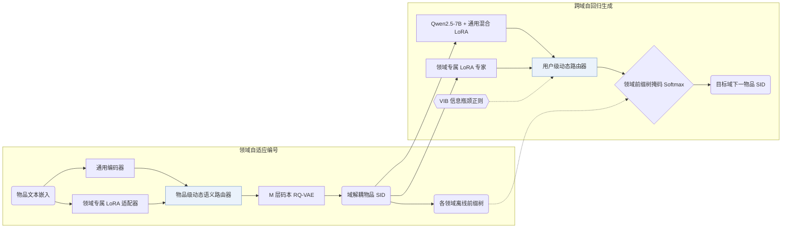

## At a Glance

Key Findings: 在 Amazon Sports-Clothing（物品重合率 1.73%）、Phones-Electronics（0.55%）与 Douban Books-Movies（7.48%）三组低重合跨域对的六个领域上，GenCDR 在 Recall@10 与 NDCG@10 上全面优于单域、生成式（TIGER、VQ-Rec）和跨域基线，且推理耗时随物品库规模扩大保持恒定（Sec. 5.1，Sec. 5.6，Table 1，Table 2，Table 3，Fig. 6）。
Limitation: 每个领域均需维护独立的 LoRA 编号器适配器与离线前缀树，且论文未报告 RQ-VAE 码本层数 M、码本大小、冲突处理策略及解码束宽（Domain-adaptive Tokenization，Domain-aware Prefix-tree，Sec. 5.1）。

### 1. 为什么重要

传统跨域推荐依赖重叠用户或共享物品 ID，而多数真实跨平台场景并不具备共享 ID；单编号器生成式方法又难以兼顾跨域共性语义与领域专有特征（Abstract）。GenCDR 将跨域自适应同时引入语义 ID（Semantic ID，SID）编号器与自回归 LLM 生成器，结合动态路由与领域前缀树完成跨域生成。

> "GenCDR first employs a Domain-adaptive Tokenization module, which generates disentangled semantic IDs for items by dynamically routing between a universal encoder and domain-specific adapters."（Abstract）

### 2. 方法

#### 领域自适应编号

在跨全部领域预训练的通用编码器旁，GenCDR 为每个领域挂载一个专属 LoRA 适配器以提取领域特有语义，再通过物品级动态语义路由网络按物品融合通用表征与领域表征，最后送入 $`M`$ 层码本的 RQ-VAE 量化为离散 SID（Domain-adaptive Tokenization）。按物品动态路由减轻了静态融合带来的负迁移。

> "To effectively integrate universal and domain-specific representations, we propose an Item-level Dynamic Semantic Routing Network that adaptively balances these representations on a per-item basis."（Domain-adaptive Tokenization）

#### 跨域自回归推荐

在 Qwen2.5-7B 生成器侧，先用全领域数据训练一组通用混合 LoRA 专家以捕捉领域无关的共性兴趣，再通过带变分信息瓶颈（VIB）正则的用户级路由网络融合通用兴趣与当前领域的专属 LoRA 表征（Cross-domain Autoregressive Recommendation）。

#### 领域感知前缀树

针对每个目标领域，GenCDR 根据编号器输出离线构建仅包含该领域合法物品 SID 序列的前缀树，并在解码时通过掩码 Softmax 将生成路径严格限制在目标领域目录内（Domain-aware Prefix-tree）。

> "Finally, a Domain-aware Prefix-tree enables efficient and accurate generation."（Abstract）

### 3. 实验发现

- 六领域主实验：在 Sports-Clothing（物品重合率 1.73%，共 704 个重叠物品）、Phones-Electronics（0.55%，404）和 Douban Books-Movies（7.48%，2,058）三组跨域对上，GenCDR 在 Recall@5/10 与 NDCG@5/10 上均优于单域、生成式（TIGER、VQ-Rec）及跨域基线（Abstract，Sec. 5.1，Table 1，Table 2）。
- 模块消融：Table 3 依次移除 MTM 组件、编号器 LoRA 适配器、领域专属专家、通用 LoRA 专家、MoE 路由门控与领域前缀树，各项移除均导致性能下降（Table 3）。
- 推理可扩展性：在 Qwen2.5-0.5B 上的评测表明，显存占用与单次推理耗时随候选物品池规模增大保持恒定，避免了 TriCDR 等全库打分方法的线性增长，与 TIGER 的扩展曲线一致（Sec. 5.6，Fig. 5，Fig. 6）。

### 4. 局限与分析

**Our analysis.**

- 编号器与各领域前缀树均离线构建并冻结（`Fixed`），新增物品或接入新领域时需重新运行路由 RQ-VAE 量化并重建对应前缀树。
- 论文未报告多项核心 SID 超参数，包括码本层数 $`M`$、每层码本大小、冲突消解方式以及解码束宽（Sec. 4.1.1，Sec. 5.1）。
- VQ-Rec 在判别式 `Encoder` 上利用离散 `OPQ` 码做跨域迁移（`Multi-Dom`）与 `Scoring`；GenCDR 则通过动态路由学习 `RQ+LoRA` 编码（`Cross-Dom`），由 `Dec-Only` LLM 在领域前缀树约束（`C-Beam`）下自回归生成目标 SID。
