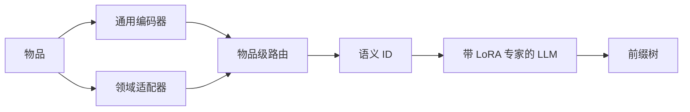

## At a Glance

Limitation: 每个领域都要加一个自己的编号器适配器和一棵离线前缀树（Domain-adaptive Tokenization，Domain-aware Prefix-tree）。

### 1. 为什么重要

传统跨域推荐依赖共享的用户或物品 ID，而大多数真实场景没有这样的 ID（Abstract）。作者指出，基于 LLM 的方法面临物品 ID 编号的两难，领域特有的建模也不够（Abstract）。GenCDR 把领域适配放进编号器本身。

> "GenCDR first employs a Domain-adaptive Tokenization module, which generates disentangled semantic IDs for items by dynamically routing between a universal encoder and domain-specific adapters."（Abstract）（在通用编码器和领域适配器之间动态路由，生成解耦的语义 ID。）

### 2. 方法

#### 领域自适应编号

每个领域一个 LoRA 适配器，和通用编码器并列，学习领域特有的表示（Domain-adaptive Tokenization）。

> "To effectively integrate universal and domain-specific representations, we propose an Item-level Dynamic Semantic Routing Network that adaptively balances these representations on a per-item basis."（Domain-adaptive Tokenization）（物品级动态路由网络按物品平衡通用表示和领域表示。）

作者认为，按物品路由能减少静态融合带来的负迁移（Domain-adaptive Tokenization）。

#### 跨域自回归推荐

生成器先在所有领域的数据上训练一组混合 LoRA 适配器，捕捉与领域无关的兴趣（Cross-domain Autoregressive Recommendation）。再用一个以变分信息瓶颈（VIB）正则的用户级路由网络，融合通用兴趣和领域兴趣（Cross-domain Autoregressive Recommendation）。

#### 领域感知前缀树

每个领域离线建一棵前缀树，存放编号器给出的全部合法 ID 序列，用来约束解码（Domain-aware Prefix-tree）。

> "Finally, a Domain-aware Prefix-tree enables efficient and accurate generation."（Abstract）（领域感知前缀树让生成又快又准。）

### 3. 实验发现

- 主实验：GenCDR 在多个真实数据集上好于基线（Abstract）。
- 消融：Table 3 分别去掉 MTM 组件、适配器、领域专家、通用专家、MoE 门和前缀树（Table 3）。

### 4. 局限与分析

**Our analysis.**

- 前缀树由编号器的输出离线构建。由此推断，新物品要重新编号并重建前缀树。
- VQ-Rec 也做跨域迁移（`Multi-Dom`），用 `OPQ` 码和 `Scoring`；GenCDR 用 `Dec-Only` LLM 生成 `RQ+LoRA` 码。
