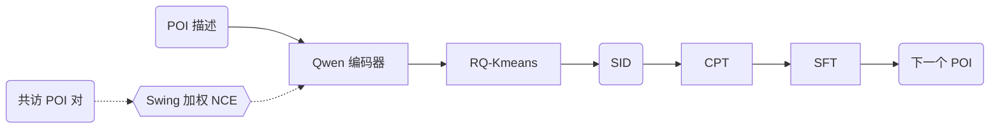
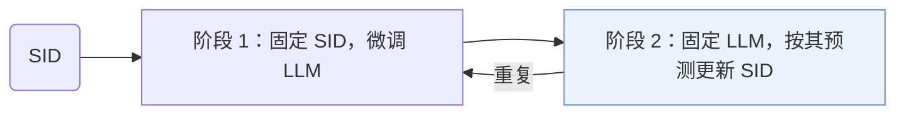

## At a Glance

Key Findings: 在高德（AMAP）平台上线三个月，GeoGR 的在线 WINRATE 提升 +2.91%，PV_CTR 提升 +5.55%（Abstract）。
Limitation: 语义 ID（Semantic ID，SID）按 LLM 的预测来更新，因此和精修时所用的 LLM 检查点绑在一起（Sec. 4.1.3）。

### 1. 为什么重要

作者指出，基于 SID 的兴趣点（POI）推荐有两个问题：SID 没有刻画跨品类的时空协同关系，和大语言模型（LLM）也对不齐（Abstract）。GeoGR 在高德这类导航服务上同时处理这两点。

> "Instead, we explicitly model the joint constraints of geographic proximity and behavioral co-occurrence by constructing spatiotemporal co-visit POI pairs."（Sec. 4.1.1）（用时空共访 POI 对显式建模地理邻近和行为共现。）

### 2. 方法

#### 位置描述

每个 POI 有一段描述，含坐标、地址和名称、品牌、品类、geohash 编码、消费水平、活跃时段等属性，由 Qwen 模型编码（Sec. 4.1.1）。

#### 共访对比学习

轨迹中经常同时出现的 POI 对按 Swing 相似度加权，以压低热门物品的权重，再用 NCE 损失训练（Sec. 4.1.1，Eq. 4）。

#### 量化与迭代精修

RQ-Kmeans 把 LLM 嵌入离散成层级 SID（Sec. 1）。

> "As shown in Algorithm 1, the framework alternates between two phases: (1) fixing the SIDs and fine-tuning the LLM to better predict them, and (2) fixing the LLM and updating the SIDs based on its predictions."（Sec. 4.1.3）（两阶段交替：固定 SID 微调 LLM；固定 LLM 按其预测更新 SID。）

#### 多阶段 LLM 训练

继续预训练（CPT）用多种提示模板注入 POI 信息和用户行为序列（Sec. 4.2.1）。之后的监督微调训练 POI 生成（Abstract）。

> "Since the newly introduced SID tokens are out-of-vocabulary for the base LLM, we first perform Continued Pre-Training (CPT) to warm up these tokens and inject scenario-specific recommendation knowledge."（Sec. 4.2）（新 SID token 不在词表里，先做 CPT 预热这些 token。）

### 3. 实验发现

- 离线对比：GeoGR 在多个真实数据集上好于基线（Abstract）。
- 在线部署：三个月的测试覆盖了数百万用户（Abstract）。

### 4. 局限与分析

**Our analysis.**

- OneLoc 在输入里加了图像，用 DPO 训练 `Enc-Dec` 生成器；GeoGR 加的是协同信号，用 `Multi-task NTP` 训练 `Dec-Only` LLM。
- GNPR-SID 的 `RQ-VAE` 码固定不变；GeoGR 的 `R-KM+EM` 码会随生成器精修。
