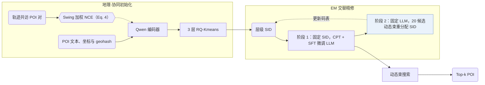

## At a Glance

Key Findings: 在高德地图（AMAP）为期三个月的线上部署中，GeoGR 取得 WINRATE +2.91% 与 PV_CTR +5.55% 的在线收益（Abstract）。
Limitation: 语义 ID（Semantic ID，SID）依赖 LLM 的预测分布迭代重分配，码本版本与精修所用的特定 LLM 检查点绑定（Sec. 4.1.3）。

### 1. 为什么重要

常规兴趣点（POI）SID 编号器难以捕捉跨品类的时空共访关系，生成的离散码也与预训练大语言模型（LLM）存在分布错位（Abstract）。GeoGR 面向高德等工业级导航场景，先用 Swing 加权的时空共访对比损失训练编码器，再通过类 EM 的两阶段循环交替优化 RQ-Kmeans 码与 Qwen 生成器。

> "Instead, we explicitly model the joint constraints of geographic proximity and behavioral co-occurrence by constructing spatiotemporal co-visit POI pairs."（Sec. 4.1.1）

### 2. 方法

#### 位置描述

每个 POI 的输入描述拼接经纬度坐标、地址以及名称、品牌、品类、geohash 编码、消费水平、活跃时段等属性，由 Qwen 编码器映射为稠密向量（Sec. 4.1.1）。

#### 共访对比学习

在用户轨迹中高频共现的 POI 对按 Swing 相似度赋权，压低热门地标的权重后以 NCE 对比损失训练编码器（Sec. 4.1.1，Eq. 4）。

#### 量化与迭代精修

RQ-Kmeans 先将对齐后的嵌入离散化为初始 3 层层级 SID（Sec. 1），随后交替更新生成器与重分配 SID：

> "As shown in Algorithm 1, the framework alternates between two phases: (1) fixing the SIDs and fine-tuning the LLM to better predict them, and (2) fixing the LLM and updating the SIDs based on its predictions."（Sec. 4.1.3）

#### 多阶段 LLM 训练

新增 SID token 不在基座词表内，GeoGR 先通过多任务提示模板执行继续预训练（CPT），注入 POI 属性与行为序列知识（Sec. 4.2.1），再经监督微调（SFT）学习下一 POI 生成（Abstract）。

> "Since the newly introduced SID tokens are out-of-vocabulary for the base LLM, we first perform Continued Pre-Training (CPT) to warm up these tokens and inject scenario-specific recommendation knowledge."（Sec. 4.2）

### 3. 实验发现

- 离线对比：GeoGR 在 Foursquare 与高德等多个真实数据集上优于传统序列推荐、POI 推荐与生成式基线（Abstract）。
- 在线部署：在高德平台覆盖数百万用户的三个月在线 A/B 测试中，GeoGR 相比线上多级召回基线取得 WINRATE +2.91%、PV_CTR +5.55% 的提升（Abstract）。

### 4. 局限与分析

**Our analysis.**

- OneLoc 在表征中引入视觉模态并用 DPO 对齐 `Enc-Dec` 生成器；GeoGR 在编号阶段融合时空共访信号，并用 `Multi-task NTP` 训练 `Dec-Only` LLM。
- GNPR-SID 在训练生成器前冻结 `RQ-VAE` 码本；GeoGR 则根据生成器的预测概率迭代精修 `R-KM+EM` 码分配。
