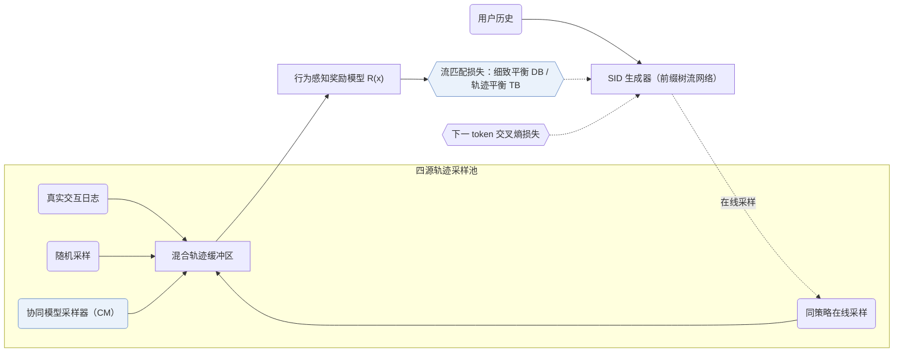

## At a Glance

Key Findings: 在淘宝生产数据上，GFlowGR 取得 H@20 = 0.444、N@20 = 0.452（SFT 为 0.358 与 0.371）；15 天线上 A/B 测试带来总收入 +0.43% 的提升（Sec. 5，Table 7）。
Limitation: 行为感知奖励模型从历史曝光日志拟合物品效用，优化上限受限于日志自身的曝光偏差（Sec. 3.2）。

### 1. 为什么重要

监督微调（SFT）的下一 token 交叉熵与 DPO 类后训练每步仅拟合单一观测目标，且将点击、转化等异构交互同等对待（Abstract）。GFlowGR 将语义 ID（Semantic ID，SID）解码建模为前缀树上的多步流生成过程，使终端物品的生成概率正比于多行为综合效用。

> "To address these challenges, we reformulate GR as a sequential set-generation problem and propose GFlowGR, a GFlowNet-based fine-tuning framework that explicitly aligns generation probabilities with item-level utilities."（Abstract）

### 2. 方法

#### 轨迹采样器

训练轨迹池汇总四类来源；单纯依赖随机采样容易引发离策略训练震荡并偏离当前生成分布，因此引入协同模型引导采样与同策略采样加以稳定（Sec. 3.1）。

> "There are four methods for constructing the trajectory set: interaction log, random sampling, CM-based sampling, and on-policy sampling."（Sec. 3.1）

#### 奖励模型

行为感知奖励模型融合多种异构用户反馈信号，为每条完整候选轨迹输出标量效用分数（Sec. 1，Sec. 3.2）。

#### GFlowNet 目标

在 SID 前缀有向无环图上施加流守恒约束，导出逐步转移的细致平衡（DB）损失与整条路径的轨迹平衡（TB）损失，并与下一 token 损失联合优化（Sec. 2）。

### 3. 实验发现

- 公开基准：GFlowGR 搭载在 TIGER 与 LETTER 两种骨干上均稳定提升推荐精度（Abstract）。
- 工业离线评测：在淘宝数据集上，GFlowGR 同时超越 SFT 与 GRPO（H@20 = 0.427，N@20 = 0.408）（Sec. 5，Table 7）。

  > "The results show that GFlowGR achieves H@20 of 0.444 and N@20 of 0.452, substantially outperforming SFT (0.358/0.371) and GRPO (0.427/0.408), mirroring the conclusions on public datasets."（Sec. 5）

- 在线部署：在抽取 10% 流量并按 50/50 切分的 15 天线上 A/B 测试中，GFlowGR 将总广告收入提升 +0.43%，并自 2025 年 5 月起在手机淘宝、闲鱼和淘宝网页版搜索广告全量部署（Sec. 5）。

### 4. 局限与分析

**Our analysis.**

- GFlowGR 仅改动生成器微调损失，与上游编号器改进（如 LETTER）正交互补。
- OneRec 按 `NTP → DPO` 串行对齐生成器；GFlowGR 则将 GFlowNet 流平衡损失作为辅助项与下一 token 似然联合训练（`NTP + Aux.`）。
