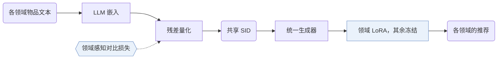

## At a Glance

Limitation: 语义 ID（Semantic ID，SID）只来自文本嵌入，协同信号只能通过生成器的训练序列进入模型（Sec. 3）。

### 1. 为什么重要

现有多目标跨域推荐（MTCDR）方法依赖领域之间共享的用户或物品，而无重叠的场景没有这些（Abstract）。基于可跨域共享的语义表示的方法，往往需要大量辅助数据做预训练（Abstract）。

> "The core idea of GMC is to leverage semantically quantized discrete item identifiers as a medium for integrating multi-domain knowledge within a unified generative model."（Abstract）（以语义量化的离散物品标识为媒介，在一个生成模型里整合多领域知识。）

### 2. 方法

#### 学习语义标识

GMC 用残差向量量化把 LLM 文本嵌入变成各领域共享的 SID（Sec. 3）。这一步还加了一个领域感知的对比损失（Sec. 3.3，Eq. 6）。

> "Specifically, since items within the same domain are generally more similar to each other than items from different domains, we introduce a novel domain-aware contrastive loss that brings quantized embeddings of intra-domain items closer together."（Sec. 1）（同领域物品通常更相似，所以用对比损失拉近同领域物品的量化嵌入。）

#### 领域专属微调

统一训练之后，每个领域得到自己的 LoRA 模块（Sec. 1，Sec. 3.5）。

> "Specifically, we incorporate domain-specific LoRA modules (Hu et al., 2022) into the unified recommender and update the corresponding LoRA parameters using domain-specific data, while freezing all other parameters of the unified model."（Sec. 1）（冻结统一模型，只用领域数据更新对应的 LoRA 参数。）

### 3. 实验发现

- 主实验：在五个公开数据集上，GMC 好于多种基线（Abstract）。

### 4. 局限与分析

**Our analysis.**

- 对比损失把同一领域的物品拉到一起。由此推断，它和跨领域共享码之间存在权衡。
- VQ-Rec 也做跨域迁移，在 `Encoder` 上用 `OPQ` 码做 `Scoring`；GMC 用 `Enc-Dec` 生成器生成 `Unified RQ` 码。
