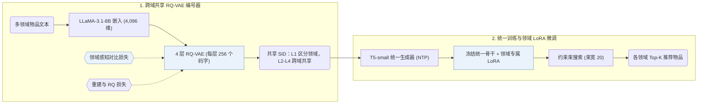

## At a Glance

Key Findings: 在五个无重叠 Amazon 领域（Scientific、Pantry、Instruments、Arts 和 Office）上，GMC 在 Recall@5、Recall@10、NDCG@5 和 NDCG@10 上均优于基于 ID、文本、预训练和生成式的基线方法（Abstract，Table 3）。
Limitation: 语义 ID（Semantic ID，SID）仅由文本嵌入生成，协同信号只能通过生成器的训练序列进入模型（Sec. 3）。

### 1. 为什么重要

现有多目标跨域推荐（MTCDR）方法依赖领域间共享的用户或物品，无法直接用于无重叠场景；而基于可共享语义表征的方法通常需要大规模辅助语料做预训练（Abstract）。GMC 通过跨域共享的离散 SID 空间与统一序列到序列生成器打通无重叠领域。

> "The core idea of GMC is to leverage semantically quantized discrete item identifiers as a medium for integrating multi-domain knowledge within a unified generative model." (Abstract)

### 2. 方法

#### 学习语义标识

GMC 用 LLaMA-3.1-8B 将各领域的物品文本编码为 4,096 维嵌入，再用 4 层 RQ-VAE（每层码本包含 256 个 32 维码字）量化为跨域共享的 SID（Sec. 3）。编号阶段加入领域感知对比损失，拉近同领域物品的量化嵌入，使第 1 层码区分不同领域、深层码在领域间共享（Sec. 3.3，Eq. 6）。

> "Specifically, since items within the same domain are generally more similar to each other than items from different domains, we introduce a novel domain-aware contrastive loss that brings quantized embeddings of intra-domain items closer together." (Sec. 1)

#### 领域专属微调

GMC 先在所有领域上用下一 token 预测训练统一的 T5-small 生成器，随后冻结统一骨干参数，为每个目标领域挂载并微调独立的 LoRA 模块（Sec. 1，Sec. 3.5）。

> "Specifically, we incorporate domain-specific LoRA modules (Hu et al., 2022) into the unified recommender and update the corresponding LoRA parameters using domain-specific data, while freezing all other parameters of the unified model." (Sec. 1)

### 3. 实验发现

- 主实验对比：在五个无重叠 Amazon 领域（Scientific、Pantry、Instruments、Arts 和 Office）上，GMC 在 Recall@5、Recall@10、NDCG@5 和 NDCG@10 上均优于基于 ID、文本、预训练和生成式的基线方法（Abstract，Table 3）。
- 消融与码共享分析：Table 4 消融了共享码本、领域感知对比损失与领域专属 LoRA 模块；Figs. 3–5 显示第 1 层码按领域分离，而深层码在领域间共享。

### 4. 局限与分析

**Our analysis.**

- 领域感知对比损失将同领域物品拉近，这意味着在较粗的量化层级上，同域聚集与跨域共享码之间存在权衡。
- VQ-Rec 在 `Encoder` 生成器上用 `OPQ` 码做 `Scoring` 实现跨域迁移；GMC 则用 `Enc-Dec` 生成器配合 `C-Beam` 解码生成 `Unified RQ` 码。
