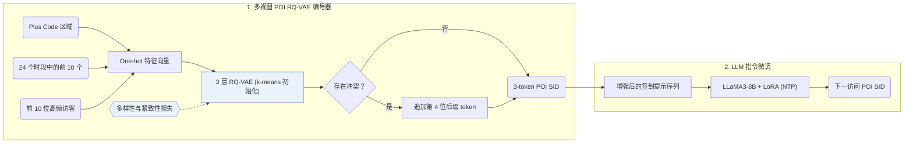

## At a Glance

Key Findings: 在三个基准数据集上，GNPR-SID 的推荐准确率（Acc@1）比对比方法最高提升 16%（Abstract）。
Limitation: 营业时段和协同特征均提取自历史签到记录，尚无访问记录的新兴趣点（POI）缺乏完整特征（Sec. 4.1.1）。

### 1. 为什么重要

现有生成式 POI 推荐方法通常为地点分配随机数字 ID，难以刻画相似地点之间的空间与语义关联（Abstract）。GNPR-SID 用融合空间、时间和协同特征并在多样性损失下训练的语义 ID（Semantic ID，SID）替代随机数字 ID。

> "To achieve this, we propose the diversity loss, which promotes the distinctiveness of codewords within each codebook layer." (Sec. 1)

### 2. 方法

#### POI 特征

GNPR-SID 为每个 POI 提取空间、时间和协同三类特征（Sec. 4.1.1）。空间特征采用 Google Plus Code 区域编码。

> "Compared to directly using geographic coordinates as spatial features, these region-based codes r ensure that nearby POIs are assigned the same Plus Code, allowing the model to share information among spatially adjacent POIs." (Sec. 4.1.1)

营业时段取 24 个小时段中访问量最高的 10 个时段，协同特征记录每个 POI 访问频次最高的 10 位访客（Sec. 4.1.1）。三类特征分别编码为 one-hot 向量（Sec. 4.1.1，Eq. 1）。

#### 量化

3 层 RQ-VAE（NYC 每层码本 32 个码字，TKY 与 CA 每层 64 个码字，维度均为 64）将融合后的 POI 表征量化为离散码；多样性损失促使各层码本内的码字在语义空间均匀分布，剩余冲突通过追加第 4 位后缀 token 消解（Abstract，Sec. 4.1.2）。

#### 训练数据

在用 LoRA 微调 LLaMA3-8B 生成器之前，GNPR-SID 对用户签到序列做多重裁剪和填空两类数据增强以扩充训练样本（Appendix A.1）。

### 3. 实验发现

- 主实验对比：在 Foursquare NYC、Foursquare TKY 和 Gowalla CA 上，GNPR-SID 的 Top-1 准确率（Acc@1）比传统方法、Transformer、GCN、时间感知模型和 LLM 基线最高提升 16%（Abstract，Table 2）。
- 消融与冲突率分析：Table 3 消融了空间、时间与协同特征以及量化损失，Table 4 统计了不同多样性损失权重下追加第 4 位后缀前的唯一 SID 数量与冲突数（NYC 在 $`\lambda = 0.25`$ 时有 590 个冲突）。
- 跨城迁移：在一个城市上训练并在其他城市的域外签到序列上测试时，GNPR-SID 保持了跨城市迁移准确率（Sec. 6.5，Table 5）。
- 效率对比：在 NYC 上，将 POI 压缩为简短 SID 序列使总测试耗时从 LLM4POI 的 230.36 s 降至 110.62 s，同时降低了训练时间与提示 token 数（Sec. 6.6，Table 6）。

### 4. 局限与分析

**Our analysis.**

- GeoGR 在交替循环中随生成器精修 `R-KM+EM` 码；GNPR-SID 的 `RQ-VAE` 码仅离线训练一次并保持固定（`Fixed`）。
- LC-Rec 用物品文本上的 `Multi-task NTP` 对齐 LLM；GNPR-SID 在编号器中融合 POI 属性、地理和协同特征（`Attr+Geo+CF`），生成器仅用标准 `NTP` 微调。
