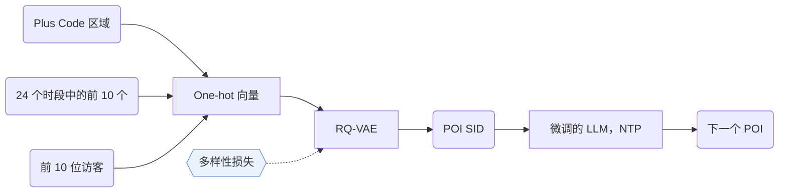

## At a Glance

Key Findings: 在三个基准数据集上，GNPR-SID 的推荐准确率比对比方法最多高 16%（Abstract）。
Limitation: 营业时段和协同特征都来自签到数据，没有访问记录的新兴趣点（POI）特征不全（Sec. 4.1.1）。

### 1. 为什么重要

现有生成式 POI 推荐通常给 POI 随机数字 ID，难以刻画相似地点之间的语义关系（Abstract）。GNPR-SID 改用从 POI 特征学到的语义 ID（Semantic ID，SID）。

> "To achieve this, we propose the diversity loss, which promotes the distinctiveness of codewords within each codebook layer."（Sec. 1）（多样性损失让每层码本内的码字彼此区分。）

### 2. 方法

#### POI 特征

每个 POI 有空间、时间和协同三类特征（Sec. 4.1.1）。区域用 Google Plus Code 表示。

> "Compared to directly using geographic coordinates as spatial features, these region-based codes r ensure that nearby POIs are assigned the same Plus Code, allowing the model to share information among spatially adjacent POIs."（Sec. 4.1.1）（相邻 POI 得到同一个 Plus Code，模型能在相邻 POI 间共享信息。）

营业时段取 24 个时间段中访问最多的 10 个，协同特征取每个 POI 最常来的 10 位访客（Sec. 4.1.1）。每种特征都变成一个 one-hot 向量（Sec. 4.1.1，Eq. 1）。

#### 量化

多样性损失让 SID 在语义空间里分布均匀（Abstract）。

#### 训练数据

附录 A.1 加了多重裁剪和填空两种数据增强（Appendix A.1）。

### 3. 实验发现

- 其他分析：论文测试了域外数据（Sec. 6.5），并从训练时间、测试时间和 token 数三方面看效率（Sec. 6.6，Table 6）。

### 4. 局限与分析

**Our analysis.**

- GeoGR 的 `R-KM+EM` 码会随生成器精修；GNPR-SID 的 `RQ-VAE` 码只训练一次。
- LC-Rec 用 `Multi-task NTP` 在文本上训练 LLM；GNPR-SID 用 POI 属性、地理和协同特征，只用普通 `NTP`。
