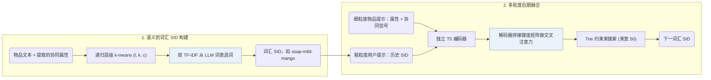

## At a Glance

Key Findings: 在四个基准数据集上，GRAM 的 Recall@5 比八个生成式推荐模型高 11.5–16.0%，NDCG@5 高 5.3–13.6%（Abstract）。
Limitation: 作者指出，用 TF-IDF 挑选词表词以及仅在大模型架构上测试小规模 T5（T5-small 和 T5-base）是主要局限（Sec. 7）。

### 1. 为什么重要

基于大语言模型（LLM）的生成式推荐难以纳入物品间的隐含协同关联，同时直接拼接冗长的物品描述会带来编码瓶颈（Abstract）。GRAM 从 LLM 原生词表中挑选词元构建层级词汇语义 ID（Semantic ID，SID），并在独立编码多粒度提示后推迟到解码阶段融合。

> "It employs separate encoders for multi-granular prompts, delaying the fusion until the decoding stage." (Abstract)

### 2. 方法

#### 语义到词汇的转换

GRAM 对物品嵌入执行递归层级 k-means 聚类（当簇内物品少于 $`c`$ 个或深度达到 $`l`$ 时停止），并通过 TF-IDF 将每个簇映射为 LLM 词表中的原生词，生成形如 `"soap-mild-mango"` 的层级词汇 SID，重复 ID 追加数字区分（Sec. 3.2.1，Sec. 7）。协同共现信号被提取并转化为附加文本属性。

> "To bridge collaborative semantics to LLMs, we extract collaborative signals and convert them as an additional item attribute." (Sec. 3.2.2)

#### 多粒度提示

粗粒度用户提示直接拼接历史交互物品的词汇 SID；细粒度物品提示则分别承载单个物品的属性文本与协同语义（Sec. 3.3.1）。

#### 后期融合

独立编码器分别处理粗粒度用户提示和各条细粒度物品提示，解码器在每一步将所有编码器输出拼接为交叉注意力的键值矩阵，并结合束宽为 50 的 Trie 约束束搜索解码目标 SID（Sec. 3.3.2，Eq. 8–9）。

### 3. 实验发现

- 主实验对比：在 Amazon Beauty、Toys and Games、Sports and Outdoors 和 Yelp 四个数据集上，GRAM 的 Recall@5 比八个生成式基线高 11.5–16.0%，NDCG@5 高 5.3–13.6%（Abstract，Table 2）。
- 组件与 ID 消融：Table 3 消融了层级聚类、协同属性和多粒度后期融合；Table 4 显示在 GRAM 框架内，层级词汇 SID 优于 RQ-VAE 码和扁平 ID。
- 推理效率：在单张 NVIDIA A6000 GPU 上单批评估全部测试序列时，GRAM 在 Beauty 和 Toys 上平均每条用户序列推理耗时分别为 0.2008 s 和 0.1605 s，而 LC-Rec 分别为 1.8312 s 和 1.8125 s（Appendix C，Tables 6–7）。

### 4. 局限与分析

**Our analysis.**

- 直接复用词表中的原生词而非新增词表外 token，意味着预训练词义可能与物品语义吻合，也可能产生语义冲突。
- LC-Rec 在 `Dec-Only` LLM 中把 `RQ-VAE` 码映射为词表外新 token；GRAM 则在 `Enc-Dec` 生成器中用词表已有词构建 `H-KM` 词汇 SID。
