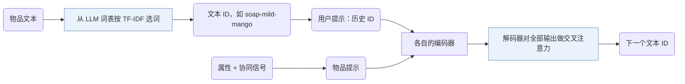

## At a Glance

Key Findings: 在四个基准数据集上，GRAM 比八个生成式推荐模型的 Recall@5 高 11.5–16.0%，NDCG@5 高 5.3–13.6%（Abstract）。
Limitation: 作者把用 TF-IDF 选词表词和只用小号 T5 模型（T5-small 和 T5-base）列为局限（Sec. 7）。

### 1. 为什么重要

基于大语言模型（LLM）的生成式推荐难以纳入物品之间的隐含关系，也难以用好丰富但冗长的物品信息（Abstract）。GRAM 用文本 ID 解决前者，用后期融合解决后者。

> "It employs separate encoders for multi-granular prompts, delaying the fusion until the decoding stage."（Abstract）（不同粒度的提示用各自的编码器，融合推迟到解码阶段。）

### 2. 方法

#### 语义到词汇的转换

层级 ID 由文字组成，例如 "soap-mild-mango"，这些词用 TF-IDF 从 LLM 词表里挑出（Sec. 7）。

> "To bridge collaborative semantics to LLMs, we extract collaborative signals and convert them as an additional item attribute."（Sec. 3.2.2）（把协同信号提取出来，当作物品的一个额外属性。）

#### 多粒度提示

粗粒度的用户提示把历史物品的 ID 拼起来；细粒度的物品提示带物品属性和协同语义（Sec. 3.3.1）。

#### 后期融合

解码器每一步都把各编码器输出拼起来，作为交叉注意力的键值矩阵（Sec. 3.3.2，Eq. 8-9）。

### 3. 实验发现

- 效率：作者在 Appendix C 分析了预处理和推理时间。

### 4. 局限与分析

**Our analysis.**

- ID 复用词表里的已有词，而不是新 token。由此推断，这些词带着预训练的含义，可能和物品吻合，也可能冲突。
- LC-Rec 在 `Dec-Only` LLM 里把 `RQ-VAE` 码映射成新 token；GRAM 在 `Enc-Dec` 模型里用 `H-KM` 文本 ID。
