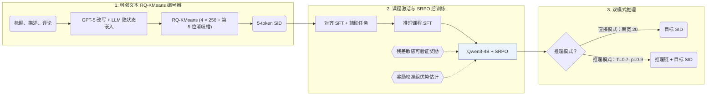

## At a Glance

Key Findings: 在 Amazon Beauty、Sports and Outdoors 和 Musical Instruments 上，GREAM 在直接模式和推理模式下均优于生成式与 LLM 基线，并将 RQ-KMeans 索引冲突率降低约 50%（Abstract，Sec. 4.1，Table 2）。
Limitation: 物品索引依赖 GPT-5 改写的描述，推理数据来自外部 LLM，复现结果受限于对这些闭源或外部模型的调用条件（Sec. 4.1，Sec. 4.2）。

### 1. 为什么重要

用大语言模型（LLM）做生成式推理推荐面临两大障碍：文本语义与协同过滤信号之间存在表征鸿沟，且用户反馈稀疏并带有随机性（Abstract）。GREAM 通过增强语义 ID（Semantic ID，SID）、合成推理课程与稀疏正则强化后训练应对这两点，同时提供低延迟直接生成和显式思维链推理两种模式。

> "GREAM natively supports two complementary inference modes: Direct Sequence Recommendation for high-throughput, low-latency deployment, and Sequential Reasoning Recommendation that first emits an interpretable reasoning chain for causal transparency." (Abstract)

### 2. 方法

#### 协同-语义对齐

对每个物品，GPT-5 将标题、官方描述与精选评论整合成统一描述，RQ-KMeans 再将其 LLM 最后一层隐状态量化为 5 位 SID（前 4 层每层码本大小 256，第 5 位为冲突消解槽）（Sec. 4.1，Eq. 4–5）。辅助对齐任务将语言表征锚定到交互语义（Abstract）。

#### 推理课程激活

外部教师 LLM 从已知目标物品出发，向用户交互历史反向推演，生成结构化的五步因果推理轨迹用于 Qwen3-4B 的课程监督微调（Sec. 4.2）。

> "This process guides the model through a structured, five-stage logical chain—behavioral evidence extraction, latent preference modeling, intent inference, recommendation formulation, and denoised sequence rewriting" (Sec. 1)

#### SRPO

稀疏正则组策略优化（SRPO）结合前缀级残差敏感可验证奖励与带奖励校准的组优势估计，使生成器在完全命中极少时仍能获得有效梯度信号（Abstract，Sec. 5.2）。

> "In the early stages of generative recommendation, exactly correct generations are typically rare." (Sec. 5.2)

### 3. 实验发现

- 主实验对比：在 Amazon Beauty、Sports and Outdoors 和 Musical Instruments 上，GREAM 在直接模式（Recall@5/10、NDCG@5/10）和推理模式（Pass@1/5/10）下均优于传统模型、Transformer、生成式基线和 LLM 基线（Abstract，Table 2）。
- 索引质量与消融：在 GPT-5 增强嵌入上执行 RQ-KMeans 使索引冲突率降低约 50%（Sec. 4.1）；Tables 3–4 验证了协同-语义对齐、推理激活与 SRPO 各阶段的贡献。
- 推理扩展性：增加推理激活阶段的合成思维链数据后，Pass@Avg 在 $`10^{16}`$–$`10^{19}`$ 训练 FLOPs 范围内呈近线性增长（Sec. 6.4，Fig. 1）。

### 4. 局限与分析

**Our analysis.**

- 推理模式需在生成目标 SID 前先输出五步推理链，这意味着其推理解码延迟和生成 token 开销高于直接束搜索模式，但原文未报告实测延迟。
- LC-Rec 和 EAGER-LLM 用 `Multi-task NTP` 训练仅解码器 LLM；GREAM 在监督对齐之后增加了强化学习后训练阶段（`NTP → RL`）。
