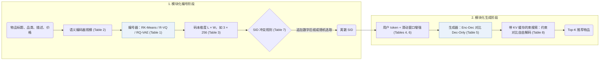

## At a Glance

Key Findings: 在 Amazon Beauty、Sports 和 Toys 上的 5 随机种子消融实验（Tables 1–8）表明，编码器-解码器结构与滑动窗口数据增强主导推荐精度，而若干高开销默认组件可替换为更高效的替代方案且不损效果（Sec. 5）。
Limitation: GRID 围绕固定的 RK-Means $`(3, 256)`$ 与 Flan-T5-XL 默认配置做单因素消融，未覆盖组件间的交互效应，也未报告束宽数值与实测推理延迟（Sec. 4.1）。

### 1. 为什么重要

现有生成式推荐（GR）工作在编号器、骨干网络、超参数与评估切分上各不相同，难以直接横向比较（Abstract）。GRID 将基于语义 ID（Semantic ID，SID）的推荐流程整合进统一的开源模块化框架，使研究者可以在固定协议下逐一替换并消融各个组件。

> "Our comprehensive experiments with GRID reveal that many overlooked architectural components in GR models with SIDs substantially impact performance." (Abstract)

### 2. 方法

#### 先编号，再生成

GRID 将基于 SID 的生成式推荐拆解为离线物品编号阶段与自回归序列生成阶段（Sec. 3.1）。

#### 编号阶段的消融

在编号阶段，GRID 围绕固定参考配置依次改变编号器算法（`RK-Means`、`R-VQ` 与 `RQ-VAE`）、预训练语义编码器参数规模，以及码本层数 $`L`$ 与每层宽度 $`W`$（Sec. 4.1，Tables 1–3）。

> "Unless otherwise noted, we use RK-Means with (L,W)=(3,256) and Flan-T5-XL." (Sec. 4.1)

#### 生成阶段的消融

在生成阶段，GRID 依次消融哈希用户 token 数量、编码器-解码器与仅解码器结构、滑动窗口数据增强、追加数字去重与冲突随机采样，以及带 KV 缓存的 Trie 约束束搜索与无约束自由束搜索（Sec. 4.2，Tables 4–8）。

### 3. 实验发现

- 可简化的组件：在 5-core Amazon Beauty、Sports 和 Toys 的 5 随机种子平均结果中，将 `RQ-VAE` 换为 `RK-Means` 或将 Trie 约束束搜索换为开销更低的无约束束搜索，均不会降低排序指标（Sec. 4.2，Sec. 5，Tables 1 and 8）。
- 关键增益来源：编码器-解码器生成器持续优于仅解码器结构，滑动窗口序列数据增强也在各基准上一致提升 Recall 与 NDCG（Sec. 5，Tables 5 and 6）。

  > "Conversely, other, often overlooked design choices prove to be vital, such as encoder-decoder architectures and data augmentation." (Sec. 5)

### 4. 局限与分析

**Our analysis.**

- 围绕 `RK-Means` $`(3, 256)`$ 与 Flan-T5-XL 默认基线每次仅变动单一维度（Sec. 4.1），这意味着跨组件交互效应（例如小码本宽度下约束解码是否更敏感）尚未得到检验。
- TIGER 用 `RQ-VAE` 码配合 `Enc-Dec` 生成器；GRID 默认采用与 OneRec 相同的 `R-KM`（`RK-Means`）编号器。
